<div align="center">

# DNS — Webots simulation environment for UAV navigation

**A reproducible warehouse world where a quadcopter has to reach a goal past fixed racks and a cart that keeps crossing its path.**


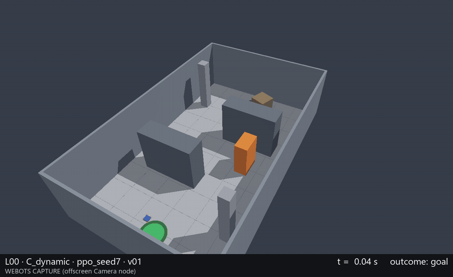

<sub>**Figure 1** — PPO checkpoint `seed7` reaching the goal on the training layout while the cart sweeps the aisle · WEBOTS CAPTURE (offscreen Camera node) · source: `assets/gifs/hero_l00_success.gif`, run `L00_C_ppo_seed7_v01`</sub>

| 540 episodes | 480 distinct configurations | 6 layouts | 10/10 cells reproduced |
|:---:|:---:|:---:|:---:|
| every one logged | identical repeats counted once | all validated and frozen first | max path difference **0 m** when the session is replayed in order |

</div>

---

## In one minute

A navigation policy that only ever saw **one** obstacle layout might have learned to navigate — or it might have learned that one room. You cannot tell the difference from inside that room.

**This repository is the room**, and the instruments that check it: the Webots world, the drone, the sensor configuration, the moving obstacle, a seeded generator that produces new layouts, and the verification that says whether any of it can be believed.

> [!NOTE]
> **What this is not.** It does not contain the PPO training code or the raw-sensor processing. Those belong to teammates and are theirs to publish. This repo records the *interfaces* and the SHA-256 fingerprints of the files it ran against.

The story in three steps:

1. **v1 built and verified one layout** — 10 × 6 m, two racks, two columns, a crate stack, and a cart crossing the aisle — and ran 90 episodes on it.
2. **v2 added five more layouts** on a graded ladder from "barely perturbed" to "deliberately hard", each validated and frozen *before* any controller saw it, then re-ran the same protocol across all six.
3. **What came out:** on an exactly mirrored layout the pooled PPO success equals the original (24/45 on both) — no sign of left–right route memorisation in this test, although that does not prove its absence — while on a harder layout whose traversability was *confirmed* by a flown reference traversal it is zero (0/45). Both results are below, with their intervals.

---

## Research direction: the benchmark phase (from 28 Nov 2026)

On the supervisor's direction, the team's benchmark is **H. Wang, F. Zhou and Q. Wu, "A Robust and Intelligent Obstacle Avoidance Method for Uncrewed Aerial Vehicles Under the Complex and Dynamic Environment", *IEEE Transactions on Vehicular Technology*, 2026**. The goal is a Q1 journal paper.

| | Benchmark (abstract level; full text still to be read) | This project |
|---|---|---|
| Input | an environment-perception network over the sensed scene | **360° 2D LiDAR only** |
| Environment | simulation | **Webots R2025a**, rigid-body quadrotor |
| Moving obstacles | pedestrians | carts and pedestrian-like movers (one cart today) |
| Start and goal | to be extracted from the paper | **randomised per episode** (fixed today) |
| Learning | reinforcement learning under observational uncertainty | **improved PPO**, trained with LiDAR uncertainty |

- **Benchmark analysis, extraction sheet and gap hypotheses:** [docs/benchmark/BENCHMARK_TVT2025.md](docs/benchmark/BENCHMARK_TVT2025.md)
- **Pipeline, contracts, work packages, experiments and timeline:** [docs/RESEARCH_PLAN.md](docs/RESEARCH_PLAN.md)
- **Traditional baselines (A\*, RRT), Ariana's prototype:** [baselines/traditional/](baselines/traditional/README.md)

The rest of this README documents the **completed v2 study** (fixed start and goal, one moving cart), which is the verified starting point for this phase.

---

## Watch

Four clips, every frame a real Webots render from an offscreen Camera node. Each one replays an episode that is already a row of `results/v2_S6/results_v2.csv` — the capture re-runs the whole session prefix first, so the footage **is** the logged run and not a lookalike. Max trajectory difference against the log: **4.99e-06 m** on all four.

<table>
<tr>
<td width="50%"><a href="assets/gifs/V-TOP_L00_success.gif">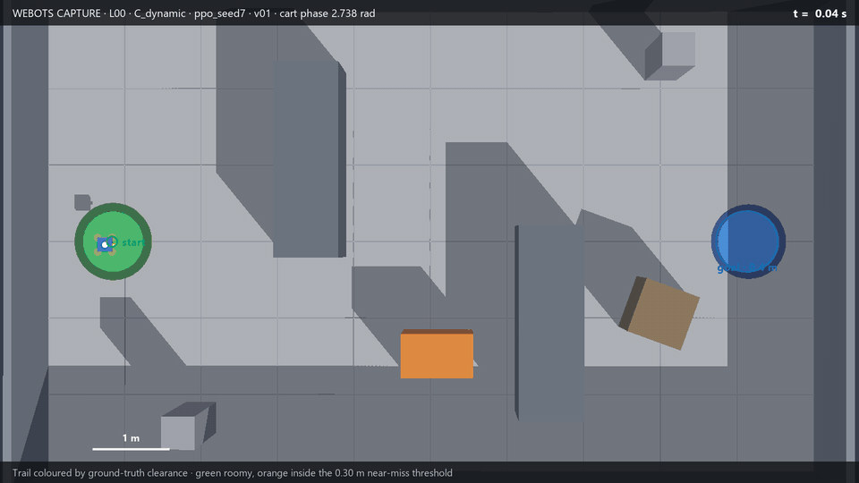</a></td>
<td width="50%"><a href="assets/gifs/V-SIDE_L00_altitude.gif">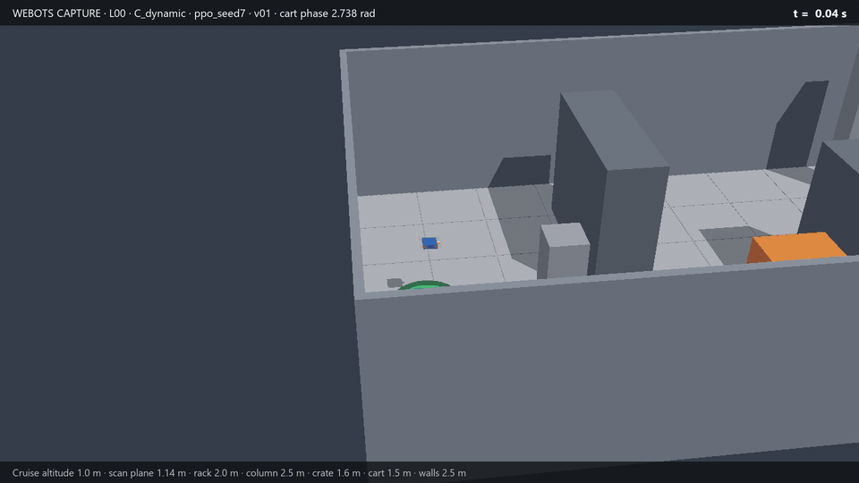</a></td>
</tr>
<tr>
<td><sub><b>V-TOP</b> — the drone threads the aisle · trail coloured by ground-truth clearance · WEBOTS CAPTURE · <code>L00_C_ppo_seed7_v01</code>, goal in 60 steps</sub></td>
<td><sub><b>V-SIDE</b> — altitude against obstacle heights · camera tracks the drone · WEBOTS CAPTURE · same episode</sub></td>
</tr>
<tr>
<td><a href="assets/gifs/V-TOP_L02_mirror.gif">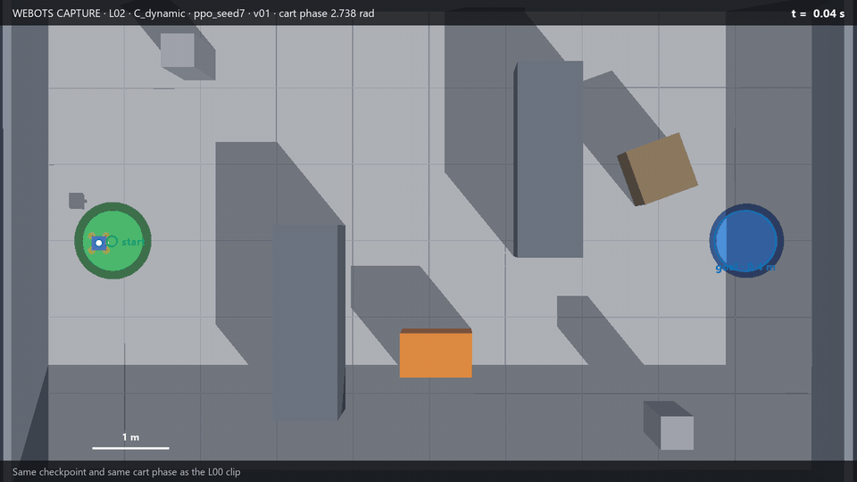</a></td>
<td><a href="assets/gifs/V-TOP_L05_failure.gif">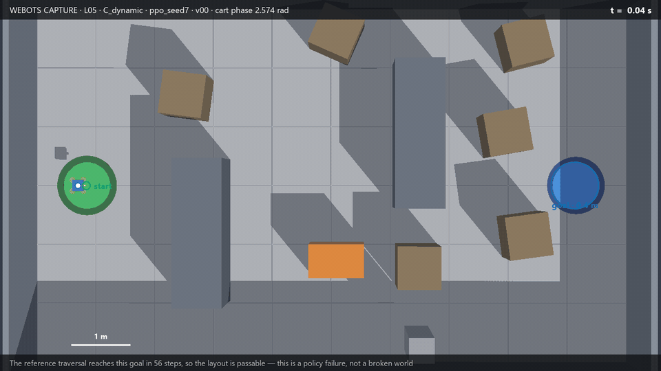</a></td>
</tr>
<tr>
<td><sub><b>V-TOP mirror</b> — same checkpoint, same cart phase, reflected layout · WEBOTS CAPTURE · <code>L02_C_ppo_seed7_v01</code>, goal in 44 steps</sub></td>
<td><sub><b>V-TOP L05</b> — the hardest layout, 0/45 pooled. The reference traversal reaches this goal in 56 steps, so the layout is passable — this is a policy failure, not a broken world · WEBOTS CAPTURE</sub></td>
</tr>
</table>

> [!NOTE]
> GitHub does not play repository MP4s inline, so each clip above is a GIF. **No GitHub release has been published yet**, so the full-resolution 1920 × 1080 MP4s are not downloadable from GitHub; they are deliberately not committed, because large binaries bloat every clone. Each clip ships a JSON sidecar (`results/video/*.json`, committed) recording its run id, cart phase, selection rule and path delta.

**Final presentation, 27 Nov 2026:** [`DNS_SimEnv_FINAL_2026-11-27.pdf`](docs/meetings/2026-11-27/DNS_SimEnv_FINAL_2026-11-27.pdf) (15 slides + 6 backups; [PPTX](docs/meetings/2026-11-27/DNS_SimEnv_FINAL_2026-11-27.pptx)). The earlier detailed and picture-first builds of the deck are kept beside it, with the [presenter kit](docs/meetings/2026-11-27/TALKING_POINTS.md) and the [meeting-day notes](docs/meetings/2026-11-27/MEETING_DAY.md). This README and the final deck make the same scientific claims.

---

## Start here — pick your role

| You are… | Read this | The one command you need |
|---|---|---|
| **the supervisor** | [One-page summary](docs/team/FOR_SUPERVISOR.md) — results, the three decisions I need from you, honest limitations | — |
| **Spencer (PPO)** | [Evaluating checkpoints](docs/team/FOR_SPENCER.md) — the contract, the TEST-ONLY rule, your results | `python scripts/run_s6.py` |
| **Sensor & perception** | [Sensor guide](docs/team/FOR_SENSOR_TEAM.md) — beam→bearing, sectors, ground-truth data, one open anomaly | `python scripts/analyse_lidar_cart.py` |
| **Traditional baselines** | [Ariana's A\*/RRT prototype](baselines/traditional/README.md) — results, caveats, and the port to Webots | open the notebook |
| **Everyone, for the next phase** | [Research plan](docs/RESEARCH_PLAN.md) — pipeline, contracts, your work package, experiments, timeline | — |
| **New contributor** | [CONTRIBUTING](CONTRIBUTING.md) and the [decision records](docs/decisions/README.md) | `python tests/test_generator.py` |
| **Just checking a number** | [`evidence/CLAIMS_EVIDENCE.csv`](evidence/CLAIMS_EVIDENCE.csv) — every claim → file → script | — |

---

## Team and responsibilities

> [!NOTE]
> Four details are still to confirm and are marked below rather than guessed: my full legal name for `CITATION.cff`, Spencer's surname and GitHub handle, the sensor teammate's name and handle, and the spelling of Ariana's name and her handle.

| Person | Role | Owns | Status | Next |
|---|---|---|---|---|
| **Khaled** ([@khh4lid](https://github.com/khh4lid)) | Simulation environment | This repository: world, drone, sensor mounting, obstacles, generator, verification | Meeting build frozen (tag `meeting-2026-11-27-v3`) | WP-ENV: reset gate, random start/goal, more movers; WP-EVAL |
| **Spencer** *(handle to confirm)* | PPO policy | `DroneNavPPO/` — training, checkpoints, `handoff.py` | 3 checkpoints evaluated | WP-PPO: document the current PPO; improved PPO, 5 seeds per variant |
| *(name to confirm)* | Sensor & perception | Raw-sensor processing | Interface + ground-truth data ready | WP-SENS: sensor v3 and a LiDAR noise model; the 0.0536 m anomaly |
| **Ariana** *(spelling and handle to confirm)* | Traditional algorithms & performance evaluation | [`baselines/traditional/`](baselines/traditional/README.md) — A\*, RRT, goal-bias study | 2D prototype complete | WP-BASE: port A\*/RRT to the Webots arena |
| **The supervisor** | Supervisor | Direction, review | — | 3 decisions ([here](docs/team/FOR_SUPERVISOR.md#decisions-i-need-from-you)) |

My five responsibilities and what each delivered: **[simulation environment dossier](docs/team/SIMULATION_ENVIRONMENT_DOSSIER.md)**. Nothing in this repository is Spencer's PPO code or the sensor teammate's processing code; their work is credited to them and reached only through the interfaces in [`docs/interfaces/`](docs/interfaces/). Ariana's baseline prototype is included, unmodified and credited, in [`baselines/traditional/`](baselines/traditional/README.md).

---

## Status, stable version and next steps

| | |
|---|---|
| **Stable reference** | `main`. The exact build shown at the 27 Nov 2026 meeting is frozen as tag [`meeting-2026-11-27-v3`](https://github.com/khh4lid/dns-webots-simulation/tree/meeting-2026-11-27-v3) (final deck); the originally frozen build is tag `meeting-2026-11-27`. Tags are never moved. |
| **Published result set** | `results/v2_S6/`: 540 episodes with the default `settle_tolerance` reset, run in one fixed order. |
| **GitHub releases** | None published yet. `v1.0` and the meeting builds exist as tags only. |
| **Done** | Arena and walls · six obstacles · the moving cart · six seeded test layouts · the verification checks · this documentation. |
| **Open** | (1) The deterministic reset misses the strict order-independence gate on 1 of 5 targets, so it is not the default ([details](#reset-reproducibility-two-cohorts-kept-apart)). (2) L04 needs a decision: keep it excluded, or authorise a longer-horizon diagnostic run. (3) More PPO training seeds (Spencer). (4) The orbit video. |
| **Next** | The benchmark phase: see the [research plan](docs/RESEARCH_PLAN.md). First, read the benchmark in full and fill its [extraction sheet](docs/benchmark/BENCHMARK_TVT2025.md#3-extraction-sheet-pdf). Pass the reset gate; then, with approval, re-run under the new reset as a separately labelled cohort. |

---

## The world

<table>
<tr>
<td width="50%">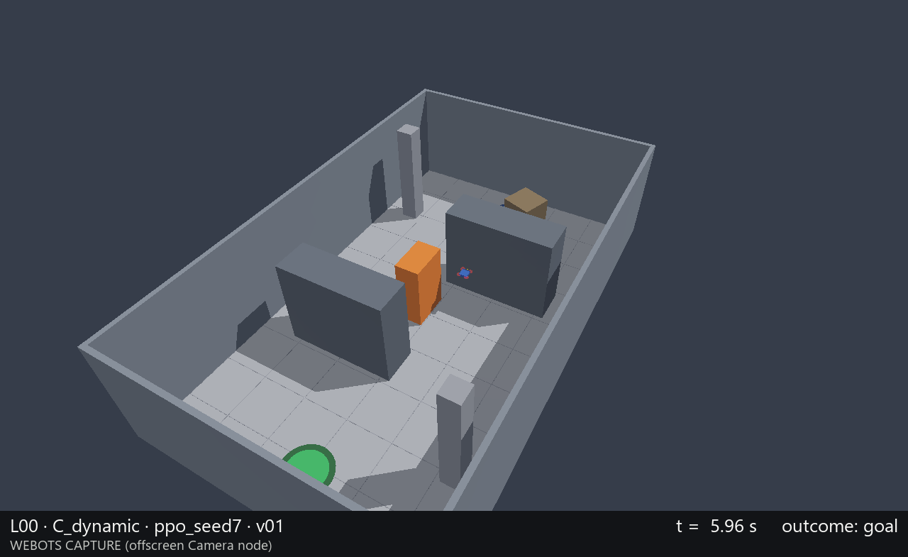</td>
<td width="50%">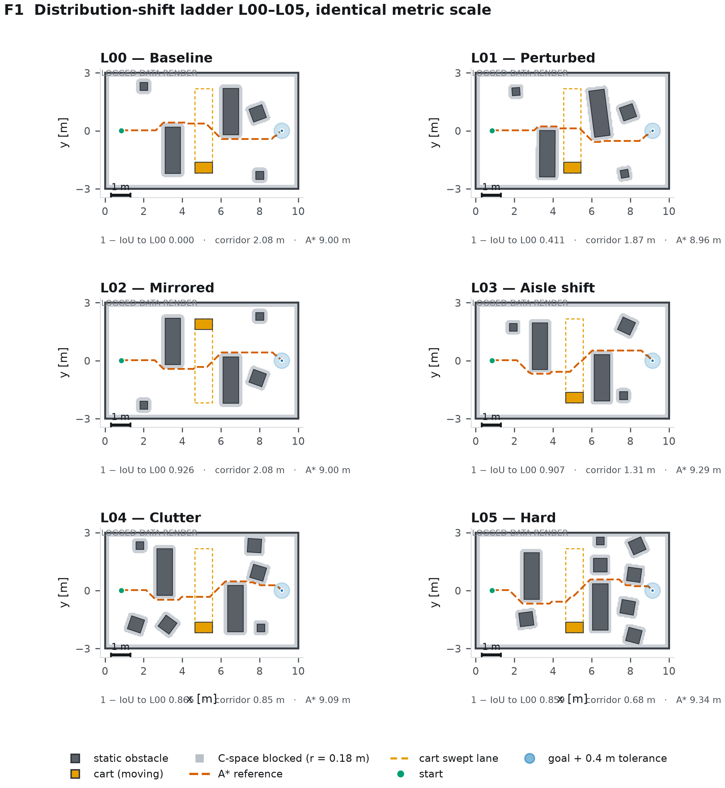</td>
</tr>
<tr>
<td><sub><b>Figure 2</b> — the arena as Webots renders it · WEBOTS CAPTURE · source: <code>assets/renders/demo_poster.png</code></sub></td>
<td><sub><b>Figure 3</b> — the six layouts at identical metric scale · LOGGED-DATA RENDER · source: <code>assets/figures/F1_shift_ladder.png</code></sub></td>
</tr>
</table>

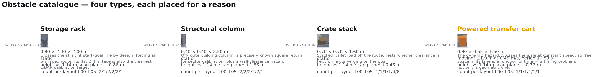

<sub><b>Figure 4</b> — the four obstacle types, their footprints and heights, and how many appear in each layout · WEBOTS CAPTURE (crops) + logged dimensions · source: <code>assets/figures/obstacle_catalogue.png</code></sub>

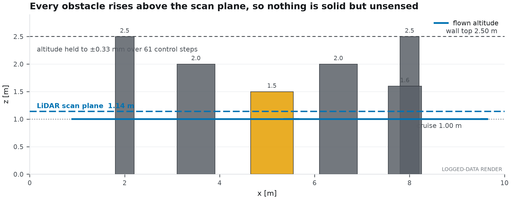

<sub><b>Figure 5</b> — every obstacle rises above the 1.14 m scan plane, so no obstacle can be hit while lying entirely below the scan. Detection is still limited to that single plane, the 5 m range and line of sight. In this episode (<code>L00_C_ppo_seed7_v01</code>) the drone held 1.0 m to within 0.33 mm over its 61 logged control steps · LOGGED-DATA RENDER · source: <code>assets/figures/side_elevation.png</code></sub>

<details>
<summary><b>Specification — every value read from <code>config/scenarios/L00_C.json</code></b></summary>

| | |
|---|---|
| Simulator | Webots R2025a, `basicTimeStep` 8 ms, ENU coordinates |
| Arena | 10.0 × 6.0 m, DNS bounds `[0, −3] → [10, 3]`, walls 2.5 m |
| Drone | `DnsQuadcopter`, 4 × `Propeller`, collision radius 0.18 m, fixed yaw |
| Flight | cruise 1.0 m, cascaded autopilot at 125 Hz, tilt limit 0.45 rad |
| Control interface | velocity setpoint every 0.200000 s (5 Hz) = exactly 25 physics steps |
| Speed cap | 1.2 m/s per axis |
| Horizon | 90 control steps (18 s) |
| Start → goal | (0.85, 0.00) → (9.15, 0.00) m, tolerance 0.4 m |
| LiDAR | 720 beams, 360°, 5.0 m cap, single layer at 1.14 m, ideal gimbal |
| Sectors | 12 × 30°; **0 front, 3 right, 6 back, 9 left** |
| Collision | geometric swept test against exact box footprints |

**Obstacles on the training layout, and why each is there**

| Body | Size (m) | Why it exists |
|---|---|---|
| `rack_a`, `rack_b` | 0.8 × 2.4 × 2.0 | Each crosses the straight start–goal line by 0.20 m, forcing an S-shaped route. A flat 2.4 m face is also the cleanest LiDAR calibration target. |
| `column_1`, `column_2` | 0.4 × 0.4 × 2.5 | Off-route building columns: a precisely known square return, plus a wall-clearance hazard. |
| `crate_stack` | 0.7 × 0.7 × 1.6, yaw 0.35 rad | Sits near the final approach — tests whether clearance is kept while converging on the goal. |
| `cart` | 0.9 × 0.55 × 1.5 | The dynamic hazard: ±1.9 m along y at 0.45 m/s, period 16.8889 s. Free space in its lane is a function of *time*, so the policy has a timing problem, not only a geometric one. |

</details>

---

## How it works

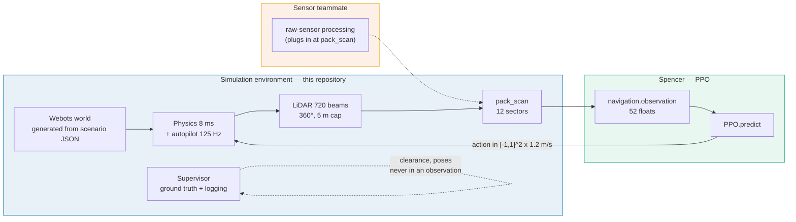

Three clocks nest exactly: **8 ms** physics, **125 Hz** inner attitude loop, **5 Hz** policy command. 0.2 s is exactly 25 physics steps, so the simulation clock cannot drift from the contract — see [ADR-008](docs/decisions/ADR-008-5-hz-velocity-commands-125-hz-loop-8-ms-step.md).

---

## The sensor

<table>
<tr>
<td width="46%">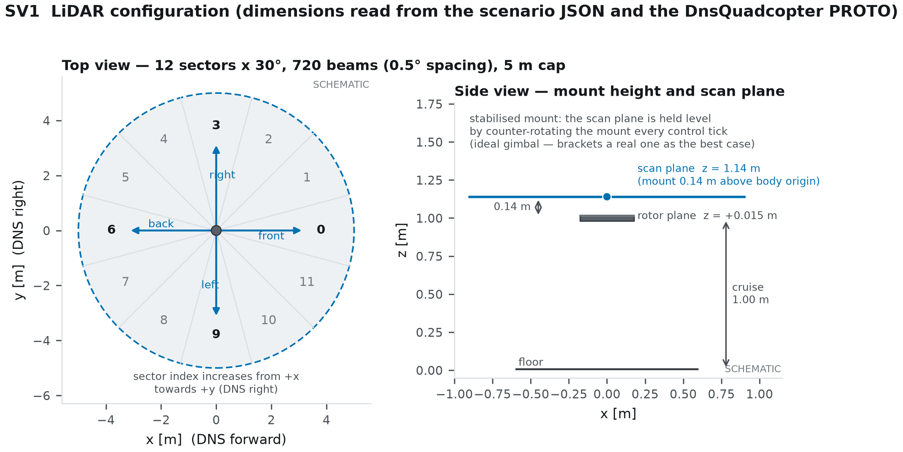</td>
<td width="54%">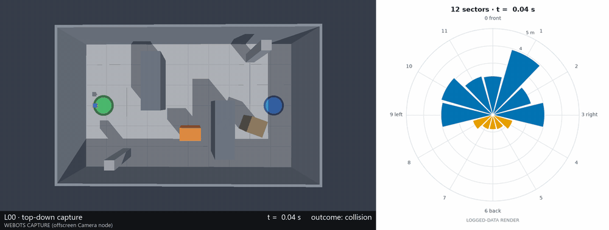</td>
</tr>
<tr>
<td><sub><b>Figure 6</b> — sensor geometry, dimensions read from the scenario and the PROTO · SCHEMATIC · source: <code>assets/diagrams/SV1_sensor_schematic.png</code></sub></td>
<td><sub><b>Figure 7</b> — the 12 sectors the policy actually receives, during a cart crossing · left WEBOTS CAPTURE, right LOGGED-DATA RENDER · source: <code>assets/gifs/lidar_sectors.gif</code></sub></td>
</tr>
</table>

Index → bearing is **measured, not assumed**. The implementation uses `bearing(i) = +1.0 × (2πi / 720) + π` (offset 180.0°), the value fitted in `results/calibration.json` (RMS 0.0147 m over 641 finite beams). A second fit in the warehouse scene gives 180.5°, one beam pitch away (RMS 0.0245 m over 671 of 720 finite beams; `results/calibration_warehouse.json`). Both fits recovered the sweep direction and the angular origin against an analytic ray cast from a known pose.

**Measurement limits.** One horizontal plane only, so nothing above or below 1.14 m is observed. Returns beyond the 5 m cap come back as `inf` and are packed as "clear to 5.0 m". A sector with no valid beam is *unknown*, not clear. The gimbal is ideal: the scan stays level whatever the airframe does ([ADR-007](docs/decisions/ADR-007-gimbal-stabilised-lidar-mount.md)). Full spec: **[Sensor interface v2](docs/interfaces/Sensor_Interface_v2.md)**.

---

## Why it is built this way

Fourteen decision records. Each states the context, the options that were on the table, what was decided, the evidence, and what it costs.

| Decision | In one line | ADR |
|---|---|---|
| **Webots R2025a** | Of the five simulators compared, the only one with a built-in LiDAR, a supervisor API for true positions, rotor physics *and* native Windows, without middleware | [001](docs/decisions/ADR-001-webots-r2025a-simulator.md) |
| **Keep 10 × 6 m** | The checkpoints were fitted on exactly this arena; enlarging it would confound layout with distribution | [002](docs/decisions/ADR-002-keep-10-x-6-m-arena.md) |
| **Fixed 1.0 m, one scan layer** | Matches the planar observation contract; every obstacle must rise above the scan plane | [003](docs/decisions/ADR-003-fixed-1.0-m-altitude-single-layer-360-deg-lidar.md) |
| **Exact boxes, not circles** | A circle around a 0.8 × 2.4 m rack reports collisions 0.50 m into empty aisle | [004](docs/decisions/ADR-004-exact-box-footprints-bounding-circles.md) |
| **Racks cross the centre line** | With the line open, "fly straight at the goal" scored 3/3 and the static test measured nothing | [005](docs/decisions/ADR-005-racks-deliberately-cross-straight-start-goal-lin.md) |
| **Kinematic cart** | Exact reproducibility — at the cost of no physical contact response | [006](docs/decisions/ADR-006-cart-is-kinematic.md) |
| **Ideal gimbal** | Makes the sector contract true; it is a best case, not a real sensor | [007](docs/decisions/ADR-007-gimbal-stabilised-lidar-mount.md) |
| **5 Hz over 125 Hz over 8 ms** | 0.2 s is exactly 25 steps, so timing is exact by construction | [008](docs/decisions/ADR-008-5-hz-velocity-commands-125-hz-loop-8-ms-step.md) |
| **Seeded generator + ladder** | A layout is data, not a hand-edited file; byte-identical across processes | [009](docs/decisions/ADR-009-seeded-generator-graded-shift-ladder.md) |
| **The mirror test** | Maximally different geometry, identical geometric difficulty — a targeted probe for left–right memorisation | [010](docs/decisions/ADR-010-mirror-test-memorisation-probe.md) |
| **Distinct configurations, Wilson** | Identical deterministic repeats count once; seeds are never ranked | [011](docs/decisions/ADR-011-distinct-configurations-wilson-intervals-no-seed.md) |
| **One source of geometry** | The run refuses to proceed if the world disagrees with the scenario | [012](docs/decisions/ADR-012-one-source-geometry-checked-against-loaded-world.md) |
| **Offscreen Camera capture** | Webots' own recorder produced 148 frames averaging 47 bytes | [013](docs/decisions/ADR-013-offscreen-camera-capture-built-in-recorder.md) |
| **L04 excluded** | 0/90 there, but the reference traversal never reached the goal either — unattributable | [014](docs/decisions/ADR-014-l04-excluded-generalisation-conclusion.md) |

<details>
<summary><b>Two of these, with their evidence images</b></summary>


<sub>**Figure 8** — both racks cross y = 0 by 0.20 m, so flying straight at the goal cannot work · LOGGED-DATA RENDER · source: `assets/decisions/ADR-005_line_block.png`</sub>


<sub>**Figure 9** — the cart's pose is an exact function of time; its t = 0 pose is the −1.9 m extreme, not the sweep centre · LOGGED-DATA RENDER · source: `assets/decisions/ADR-006_cart_spacetime.png`</sub>

</details>

---

## Verification — we check the simulator instead of trusting it

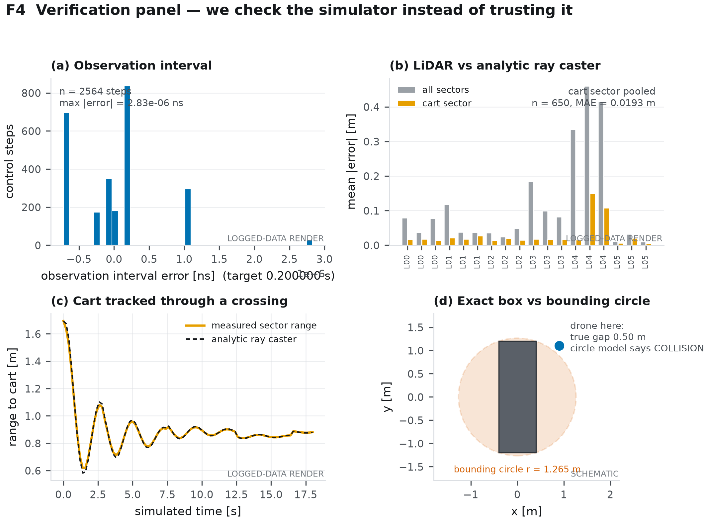

<sub>**Figure 10** — verification panel · LOGGED-DATA RENDER and SCHEMATIC · source: `assets/figures/F4_verification_panel.png`</sub>

| Check | Method | Result |
|---|---|---|
| Observation interval | measured as simulated time, every logged step | **0.200000 s**, error < 3e−16 s |
| Reset start pose | position after teleport-and-settle vs the configured start | **2.8 µm** (pose only; the default reset does not clear residual velocity or controller state, see [Reset reproducibility](#reset-reproducibility-two-cohorts-kept-apart)) |
| World ↔ scenario | every obstacle's t = 0 pose read back from the running simulator | **≤ 4.0e−06 m**, all 6 layouts |
| Frozen contracts | 26 executable tests per layout | **26/26**, all 6 layouts |
| LiDAR angular map | fit index→bearing against analytic geometry | RMS **0.025 m** per beam |
| LiDAR full scan | vs analytic ray caster, all beams incl. occlusion | mean **0.048 m** per beam |
| **LiDAR ↔ moving cart** | measured sector vs ray caster at the *logged cart pose* | **MAE 0.0193 m**, n = 650 |
| L00 reproduction | re-run v1's protocol on the regenerated world | **10/10 cells**, 0 m path difference *when the session is replayed in order*; a single episode in isolation can drift up to 0.287 m ([detail](docs/verification/RESET_DETERMINISM.md)) |
| Airframe stability | peak tilt per episode | 3 of 540 exceeded 0.50 rad |

<details>
<summary><b>What verification actually caught — six problems: five fixed, one open</b></summary>

These are the reason the checks exist. The five fixed defects are now regression tests; the register is [`evidence/DEFECTS.csv`](evidence/DEFECTS.csv).

1. **Racks collided as circles.** A 0.8 × 2.4 m rack has a 1.265 m bounding radius, so the drone "collided" 0.50 m deep in empty aisle. Fixed with exact box distance, slab ray intersection and a swept test.
2. **The camera generator rotated about the vertical axis instead of tilting** — every rendered frame was empty sky. Invisible because the runs were headless.
3. **The world file placed the cart at its motion centre, not its t = 0 pose** — a 1.9 m mismatch that corrupted a calibration reference by 1.34 m.
4. **The calibration tool loaded a fixed scenario**, so it compared one world's measurements against another world's geometry.
5. **v1 shipped a `protocol.json` describing a different run than its own `results.csv`** (found during this release). Fixed by per-run manifests and scenario hashes stamped into every world.
6. **Open: the episode reset settles to a tolerance, not a fixed point,** so residual state from the previous episode leaks into the next one. An episode replayed in isolation drifts up to 0.287 m from its logged path. See [Reset reproducibility](#reset-reproducibility-two-cohorts-kept-apart).

Full corrections C1–C9: **[V1_CORRECTIONS.md](docs/verification/V1_CORRECTIONS.md)**.

</details>

---

## Results

### The ladder

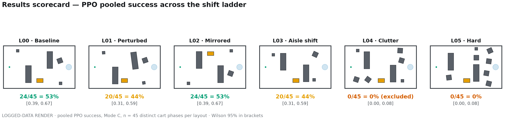

<sub>**Figure 11** — results scorecard · LOGGED-DATA RENDER · source: `assets/figures/scorecard.png`</sub>

| Layout | What changes | IoU vs L00 | Corridor (m) | **PPO Mode C pooled [Wilson 95%]** | Reference traversal |
|---|---|---|---|---|---|
| **L00** Baseline | the training layout | 1.000 | 2.08 | **24/45 = 0.533** [0.391, 0.671] | goal, 50 steps |
| **L01** Perturbed | positions ±0.3 m, yaw ±10° | 0.589 | 1.87 | **20/45 = 0.444** [0.309, 0.588] | goal, 50 steps |
| **L02** Mirrored | reflected about y = 0 | 0.074 | 2.08 | **24/45 = 0.533** [0.391, 0.671] | goal, 51 steps |
| **L03** Aisle shift | racks moved, sides swapped | 0.093 | 1.31 | **20/45 = 0.444** [0.309, 0.588] | goal, 52 steps |
| **L04** Clutter | extra crate stacks | 0.135 | 0.85 | *0/45 — **excluded**, see below* | **not reached** |
| **L05** Hard | narrow gate + occluded goal | 0.141 | 0.68 | **0/45** [0.000, 0.079] | goal, 56 steps |

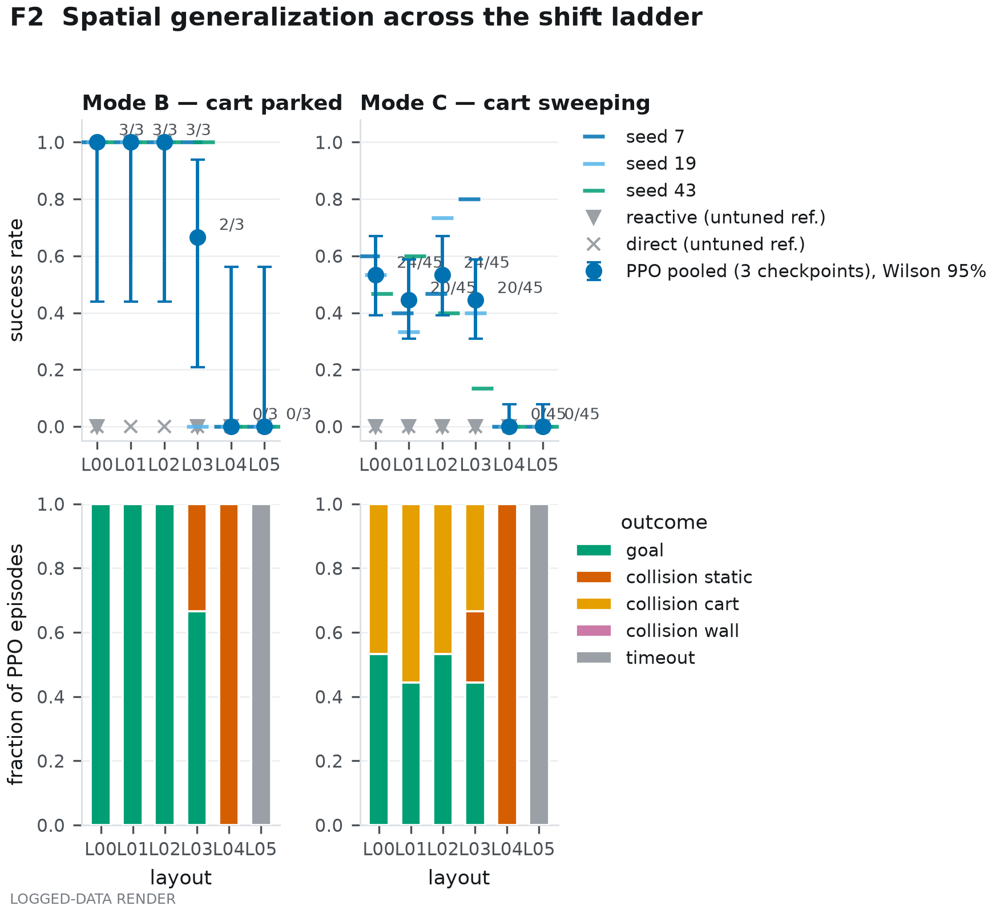

<sub>**Figure 12** — generalisation across the ladder, with per-checkpoint points and the failure taxonomy · LOGGED-DATA RENDER · source: `assets/figures/F2_generalization.png`</sub>

> [!IMPORTANT]
> **How to read these numbers.**
> - **540 episodes, 480 distinct configurations.** Mode C varies the cart phase 15 ways, so n = 15 per cell. Mode B's three episodes are the *same* configuration run three times — the episode seed is accepted by `reset()` and never used — so **n = 1** there. Identical deterministic repeats count once.
> - Rates are **pooled over the three checkpoints** with Wilson 95% intervals. Per-checkpoint values are plotted but **never ranked**: their intervals overlap almost completely (on L00 they are 9/15, 8/15 and 7/15).
> - **No significance tests.** Six layouts with one seed per family is a pilot, not a distribution; no trend is fitted.

> [!IMPORTANT]
> **The Wilson intervals are approximate.** A Wilson interval assumes
> independent trials. The 15 cart-phase variants inside a cell are run back
> to back and are coupled through residual airframe state across the reset
> (`docs/verification/RESET_DETERMINISM.md`), so they are not strictly
> independent draws, and the intervals should be read as indicative rather
> than exact.


### The mirror test

L02 is L00 reflected about y = 0 — so it is maximally *different* (occupancy IoU **0.074**, mean obstacle displacement **3.00 m**) while being geometrically just as *hard*: identical A\* length (9.004 m), tortuosity (1.085), corridor width (2.080 m) and intrusion depth (0.200 m), all asserted by unit test.

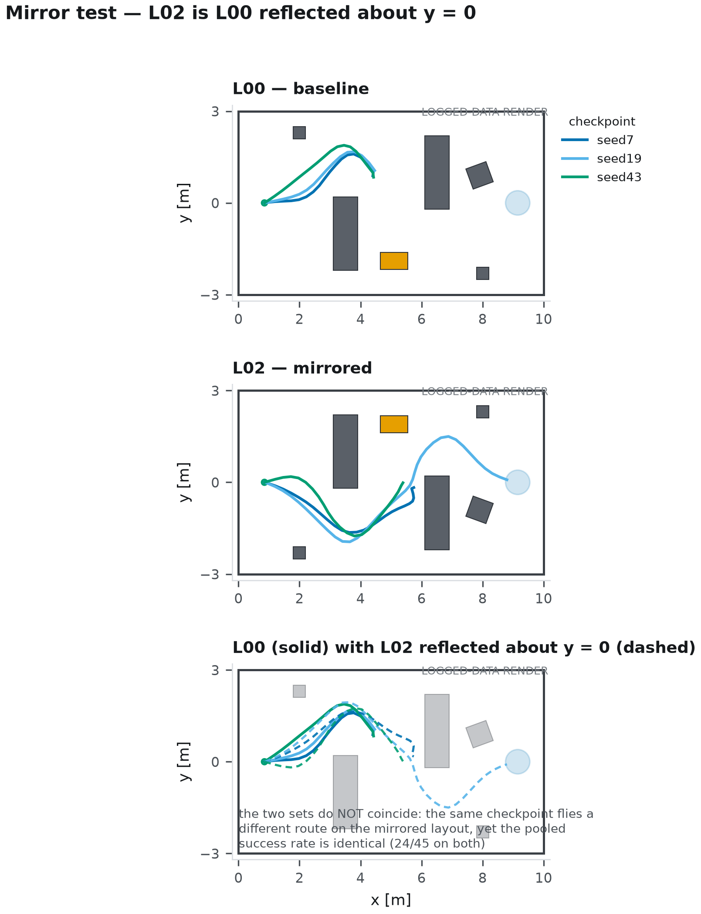

<sub>**Figure 13** — visual proof the mirrored layout was actually flown mirrored · LOGGED-DATA RENDER · source: `assets/figures/E15_mirror_overlay.png`</sub>

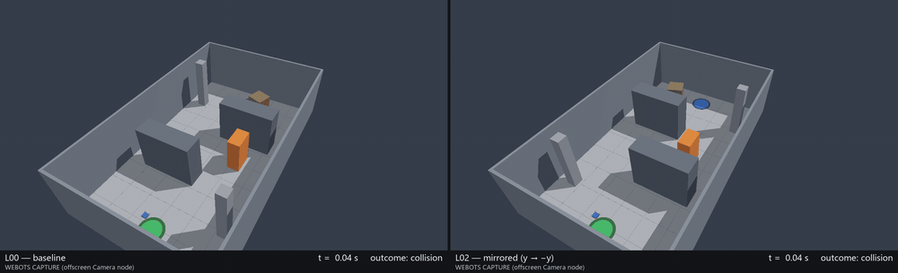

<sub>**Figure 14** — same checkpoint, same cart phase, mirrored geometry · WEBOTS CAPTURE · source: `assets/gifs/mirror_l00_vs_l02.gif`</sub>

> [!NOTE]
> **The claim, stated narrowly.** The pooled result is the same on L00 and L02 (24/45 both), and the reflected trajectories do **not** retrace the originals — the same checkpoint flies a genuinely different route. That is **no evidence of left/right layout memorisation in this test**.
>
> It does **not** prove the absence of spatial memorisation: there is one seed per layout and the intervals are wide ([0.391, 0.671] on both). Nor is it a claim that the policy generalises. The counterweight is **L05: 0/45**, on a layout whose traversability was confirmed by a flown reference traversal reaching the goal in 56 steps. Read the two together. (L00 and L02 also stay equal in the separately reported deterministic-reset cohort; see [Reset reproducibility](#reset-reproducibility-two-cohorts-kept-apart).)

A phase-by-phase comparison is in [`assets/figures/E16_mirror_phases.png`](assets/figures/E16_mirror_phases.png); the full analysis is in [RESULTS_v2](docs/results/RESULTS_v2.md).

### Why L04 is excluded

All five controllers score 0/90 on L04 — but so does the environment's own reference tracker, which is *given* the correct route:

| Planning margin | Tracker speed | Outcome | Peak tilt |
|---|---|---|---|
| 0.22 m | fast profile | collision at 10 steps | 0.2496 rad |

> [!WARNING]
> A wider multi-profile sweep was run (slow profiles timed out without
> colliding; a 0.12 m margin tumbled the airframe to 1.5905 rad), but
> `results/layout_gate/L04.json` was overwritten by a later single-profile run,
> so only the row above is currently backed by a file. Regenerate with
> `python scripts/run_gates.py L04` before citing the rest. The exclusion does
> not depend on the missing rows — the tracker fails in the attempt on file.

In the wider sweep (rows not currently on file) slow profiles timed out without colliding, and faster ones clipped the same crate the PPO checkpoints hit. The final presentation summarises this as the reference path failing at every speed tried; until the sweep is regenerated, only the fast-profile attempt above is backed by a file. Either way, "the policies fail to generalise" cannot be separated from "this layout may be outside the airframe's envelope within the 18 s horizon", so reporting the former would be a claim the evidence does not support. **This does not show that L04 is physically impassable.** The data is kept in full. **[ADR-014](docs/decisions/ADR-014-l04-excluded-generalisation-conclusion.md)** · *decision pending from the supervisor: keep L04 excluded, or authorise a longer-horizon diagnostic run.*

### Why `direct` and `reactive` score 0

Both are untuned reference controllers from Spencer's code, shown for context and never used to rank methods.

- **`direct`** flies straight at the goal. Both racks cross that line by design ([ADR-005](docs/decisions/ADR-005-racks-deliberately-cross-straight-start-goal-lin.md)), so it collides with `rack_a` at x ≈ 2.98 m every time.
- **`reactive`** is a potential field. v1 explained its failure by comparing the 1.45 m repulsion radius against the crate's **centre** distance (1.54 m) — but the controller reacts to the nearest **LiDAR return**, i.e. the *surface*, which is **1.0582 m** away. The conclusion survived; the arithmetic did not. The measured mechanism is cumulative repulsion from the racks and walls (peak magnitude **1.8654** against a unit attractive term) slowing it until it times out **1.6167 m** short.

---

## Reset reproducibility: two cohorts kept apart

| | Published cohort | Experimental cohort |
|---|---|---|
| Reset mode | `settle_tolerance` (**default**) | `deterministic` (opt-in) |
| Results folder | `results/v2_S6/` | `results/v2_S6_deterministic/` |
| What the reset does | hover until speed < 0.02 m/s and \|altitude − 1.0\| < 0.02 m, up to 6 s | clear the autopilot integrator, then a fixed 750 steps (6.0 s) re-asserting pose and zero velocity after every step |
| One episode, isolated vs after a prefix | up to **0.287 m** apart (5 targets, L00, `ppo_seed7`) | worst **2.139e-04 m** (5 targets × 2 controllers) |
| Strict order-independence gate: identical outcomes and step counts, path drift ≤ 1e-5 m | not met | met on 4 of 5 targets, **not met** on 1 (`ppo_seed7`, v01) |
| Status | the result set in this README and in the final deck | not the default; no published number uses it |

1. **The original reset.** `settle_tolerance` stops when the drone is steady enough rather than at a fixed point, so some state survives into the next episode: position, velocity, the autopilot integrator and the sector ranges the policy reads. Replayed in session order, episodes match their logs to about 5e-06 m. Run in isolation, they drift 1.6 mm to 287 mm ([RESET_DETERMINISM](docs/verification/RESET_DETERMINISM.md)).
2. **The experimental reset.** The `deterministic` mode removes almost all of it. Independent reproducibility tests ran each target in isolation and after two different predecessors: 5 targets × 2 controllers × 3 orderings, in `results/reset_validation/`. Outcomes and step counts agreed 5/5, but the worst path difference, 2.139e-04 m, is above the strict 1e-5 m bar. The mode is therefore **not yet the default** and is not approved for published results.
3. **Where the code is.** The mode is part of `dns/backend.py` on `main` as an opt-in setting (`WebotsBackend.reset_mode`), and the default is unchanged. Branch `reset-fix-v2.1` points at the same commit, which is already contained in `main`. Older notes saying the fix is "on its own branch" or "not merged" mean that it is not the default and no published number uses it. They do not mean the code is absent from `main`.
4. **The second cohort.** All 540 episodes were also re-run under the experimental reset. PPO Mode C reached 23/45 on L00, 22/45 on L01, 23/45 on L02, 20/45 on L03, and 0/45 on L04 and L05; 15 of 540 episodes changed outcome. This is a separately reported robustness check and never replaces the published numbers. L00 and L02 stay equal under both resets ([RESET_MODE_COMPARISON](docs/verification/RESET_MODE_COMPARISON.md)).
5. **Next.** Pass the strict gate. Then, with approval, make the new reset the default and re-run, publishing the result as a new, separately labelled cohort.

---

## What we corrected from v1

| # | v1 said | Correct | Evidence |
|---|---|---|---|
| **C1** | repulsion radius 1.45 m > crate-to-goal 1.54 m | 1.54 m is the *centre*; the surface is **1.0582 m**. Real cause: cumulative repulsion, timeout 1.6167 m short | [`reactive_gnron_analysis.json`](results/v2_S6/reactive_gnron_analysis.json) |
| **C2** | "cart vs model 0.00e+00 m" as headline evidence | True by construction → implementation-consistency check. Replaced by LiDAR–cart MAE **0.0193 m**, n = 650 | [`lidar_cart_consistency.json`](results/v2_S6/lidar_cart_consistency.json) |
| **C3** | Mode B "3/3" per controller | **1/1** — the seed is accepted but unused. Pooled 3/3, Wilson [0.439, 1.000] | [`v1_distinctness.json`](results/v2_S6/v1_distinctness.json) |
| **C4** | per-seed 9/15, 8/15, 7/15 discussed as a ranking | Pooled **24/45**, Wilson [0.391, 0.671]; intervals overlap, never ranked | [`pooled_rates.csv`](results/v2_S6/pooled_rates.csv) |
| **C5** | "RMS 0.025 m", "mean 0.048 m" | Defined: per-beam, absolute; one is the angular-map fit, the other a full occluded scan | [Verification](docs/verification/V1_CORRECTIONS.md) |
| **C6** | modes used without definition | Mode A/B/C defined once and used consistently | [Protocol §4](docs/verification/S6_GENERALIZATION_PROTOCOL.md) |
| **C7** | — | `ppo.py` is a **from-scratch NumPy PPO**, not Stable-Baselines3; SB3 is not cited | [ADR index](docs/decisions/README.md) |
| **C8** | — | v1 shipped a `protocol.json` describing a **different run** than its `results.csv` | [AUDIT_SUMMARY](docs/verification/AUDIT_SUMMARY.md) |
| **C9** | — | L00 reproduces 10/10 cells with 0 m path difference **when the session is replayed in order** | [`v1_reproduction.csv`](results/v2_S6/v1_reproduction.csv) |

Full detail with before → after → evidence: **[V1_CORRECTIONS.md](docs/verification/V1_CORRECTIONS.md)**.

---

## Limitations and open questions

| Issue | Impact | Owner |
|---|---|---|
| **L04 traversability unconfirmed** | One rung of the ladder yields no conclusion | the supervisor — decision pending |
| **Cart contact is not physical** | `collision_cart` means swept footprints intersected, not that an impact was simulated | Me — would need a `Physics` node |
| **Ideal gimbal** | A best case, not a real sensor. Ideal-ON and body-fixed-OFF bracket a real one; the bracket run is not done | Me |
| **Single episodes are not independently reproducible** under the default reset — drift 1.6 mm to 287 mm; see [RESET_DETERMINISM](docs/verification/RESET_DETERMINISM.md) | Episodes in a cell are coupled through residual state and are not strictly independent draws | Me |
| **Deterministic reset not yet the default** | It removes most residual state but misses the strict 1e-5 m gate on 1 of 5 targets (worst 2.139e-04 m); no published number uses it | Me — after the gate passes, and with approval |
| **Reset fails after a tumble** | A tumbled airframe cannot re-settle within its 6 s budget, aborting the next episode | Me |
| **Sensor reading 0.0536 m vs 0.62 m ground truth** | Unexplained; matters because repulsion scales with `1.45 − range` | Sensor teammate |
| **Three training seeds** | Cannot separate checkpoint variance from layout effects | Spencer |
| **Six layouts, one seed per family** | A pilot, not a distribution; no trend is fitted | Me |

Full register: **[ASSUMPTIONS.md](docs/verification/ASSUMPTIONS.md)**.

---

## Repository map

```
assets/        every visual: figures, gifs, renders, diagrams, decisions
baselines/     traditional planners: Ariana's A*/RRT prototype (notebook, report, slides)
config/        scenario definitions; scenarios/ holds the 12 canonical JSONs + hashes
dns/           the simulation package (scenario, backend, autopilot, sensing,
               generator, feasibility, worldcheck, worldgen)
docs/          team guides, interfaces, ADRs, verification, results, meetings,
               benchmark/ (the TVT 2025 benchmark) and RESEARCH_PLAN.md
evidence/      CLAIMS_EVIDENCE.csv, baseline hashes, environment, release state
protos/        DnsQuadcopter.proto — airframe, rotors, LiDAR mount, demo camera
results/       v1_L00/ (90 episodes) and v2_S6/ (540 episodes + per-run folders)
scripts/       generator drivers, experiment runners, figure and clip builders,
               security scan, freeze/verify
tests/         26 unit tests + the Webots clients (gate, experiment, capture)
worlds/        generated .wbt — one per layout and mode, stamped with its hash
```

Each folder has its own README. The full v2 migration map is [`evidence/FILE_MAP.md`](evidence/FILE_MAP.md).

---

## Quick start (Windows)

**Prerequisites:** Webots R2025a, Python 3.15 (verified with 3.15.2; see `evidence/ENVIRONMENT.txt`) and the packages in `requirements.txt`. Anything that steps a policy also needs Spencer's `DroneNavPPO` tree beside this repository, or `DNS_PPO_DIR` pointing at it. That tree is **not included here**.

```powershell
git clone https://github.com/khh4lid/dns-webots-simulation.git
cd dns-webots-simulation
python -m pip install -r requirements.txt
$env:WEBOTS_HOME = "C:\Program Files\Webots"   # wherever yours is
```

| What | Command | Expect |
|---|---|---|
| Unit tests — no Webots needed | `python tests/test_generator.py` | 26 passed · ~2 min |
| Rebuild figures and tables from logs | `python reproduce.py --fast` | ~3 min |
| Open the training world | `& "$env:WEBOTS_HOME\msys64\mingw64\bin\webots.exe" worlds\DNS_L00_C.wbt` | the drone waits for a client |
| Verify one layout | `python scripts/run_gates.py L00` | 26/26 contracts, traversal `goal` · ~20 s |
| Re-run one layout's 90 episodes | `python scripts/with_webots.py --boot-wait 12 --timeout 1500 --world worlds/DNS_L03_C.wbt tests/client_s6_experiment.py -- --layout L03` | ~3 min |
| Re-run everything | `python reproduce.py --full` | 540 episodes · ~19 min |
| Prove the baseline is untouched | `python scripts/freeze.py --verify` | `PASS` |
| Interface unit tests | `python tests/unit_tests.py` | needs Spencer's `navigation.py` via `DNS_PPO_DIR` |
| Check the documentation links | `python scripts/check_docs.py` | 0 problems |

**Where things are**

| You need | Look in |
|---|---|
| Scenario definitions | `config/scenarios/L0*_B.json` (cart parked) and `L0*_C.json` (cart moving), with `HASHES.txt` |
| Worlds | `worlds/DNS_L0*_{B,C}.wbt`, generated from the scenarios (never hand-edited) |
| Published results | `results/v2_S6/`: `results_v2.csv`, `pooled_rates.csv`, `scenario_table.csv` |
| One episode | `results/v2_S6/runs/<run_id>/`: `trajectory.csv`, `events.csv`, `obstacles.csv`, `manifest.json` |
| Sample LiDAR ground truth | the 60 runs in `results/v2_S6/runs/` that carry a `lidar.npz`; analysed by `python scripts/analyse_lidar_cart.py` |
| PPO interface | [PPO interface v2](docs/interfaces/PPO_Interface_v2.md): 52-number observation in, 2-number action out, every 0.2 s |
| Sensor interface | [Sensor interface v2](docs/interfaces/Sensor_Interface_v2.md) |

**Contributing.** Branch from `main` as `feature/<name>`, `fix/<name>` or `docs/<name>`, open a pull request and work through the checklist in [CONTRIBUTING](CONTRIBUTING.md). No force-pushes and no history rewriting. Results folders are append-only, and meeting tags are never moved.

<details>
<summary><b>Troubleshooting</b></summary>

- **`Supervisor()` hangs.** Webots must be running with a robot whose controller is `<extern>`. Always launch through `scripts/with_webots.py`, which starts Webots on a free port, runs the client as a subprocess with a timeout, and tears it down.
- **Recorded video is blank.** Webots' built-in recorder produces empty frames in this environment and `exportImage` returns a uniform fill. Use the offscreen Camera path (`tests/client_capture.py`) — see [ADR-013](docs/decisions/ADR-013-offscreen-camera-capture-built-in-recorder.md).
- **Webots not found.** Set `WEBOTS_HOME`, or let `dns/launcher.py` probe the usual install locations.
- **A world looks wrong.** Do not edit the `.wbt`. Change the scenario JSON and run `python scripts/build_worlds.py`; `dns/worldcheck.py` will reject any drift.

</details>

---

## Figure gallery

<table>
<tr>
<td></td>
<td></td>
<td>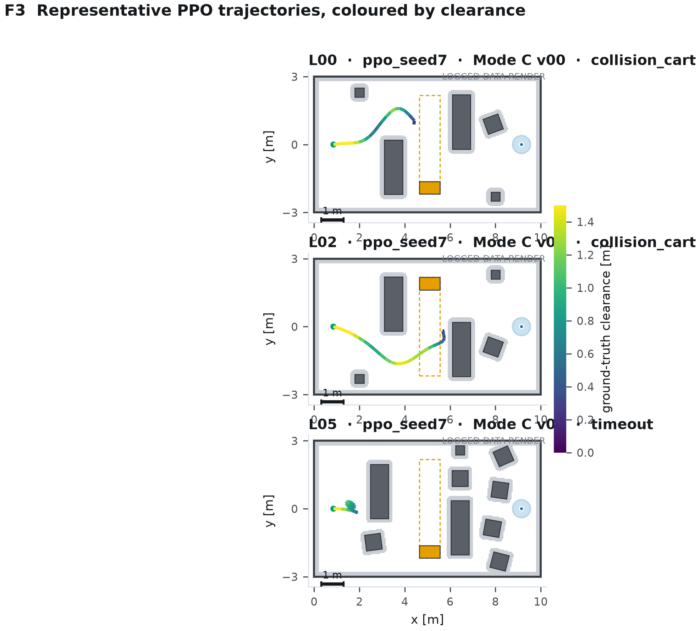</td>
</tr>
<tr>
<td><sub>F1 — shift ladder</sub></td><td><sub>F2 — generalisation</sub></td><td><sub>F3 — trajectories</sub></td>
</tr>
<tr>
<td></td>
<td>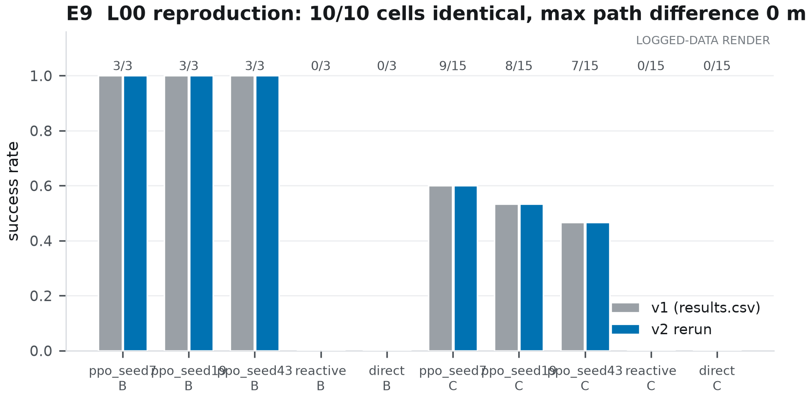</td>
<td>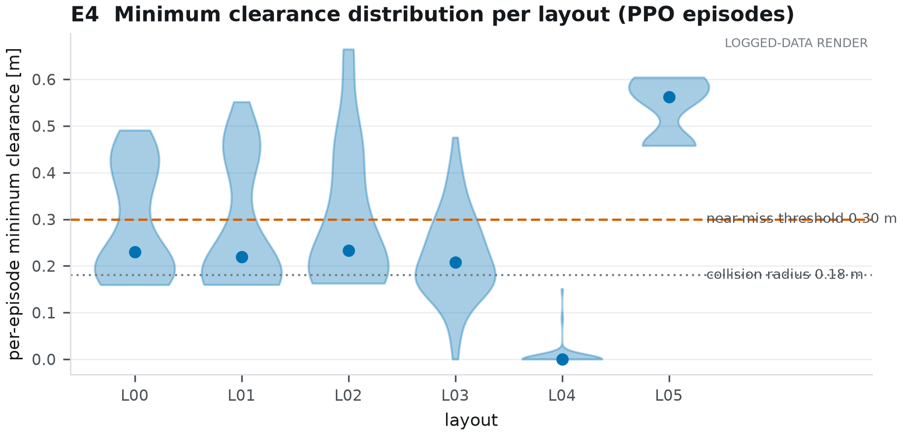</td>
</tr>
<tr>
<td><sub>F4 — verification</sub></td><td><sub>E9 — L00 reproduction</sub></td><td><sub>E4 — clearance</sub></td>
</tr>
<tr>
<td></td>
<td></td>
<td></td>
</tr>
<tr>
<td><sub>Obstacle catalogue</sub></td><td><sub>Side elevation</sub></td><td><sub>Mirror overlay</sub></td>
</tr>
</table>

Every figure with its n, data file, script and provenance: **[docs/FIGURES.md](docs/FIGURES.md)**.

---

## References

Verified against a DOI, arXiv ID or publisher page before being cited.

- Michel, O. (2004). *Webots: Professional Mobile Robot Simulation.* **Int. J. Adv. Robot. Syst. 1**(1), 39–42. [doi:10.5772/5618](https://doi.org/10.5772/5618)
- Schulman, J. et al. (2017). *Proximal Policy Optimization Algorithms.* [arXiv:1707.06347](https://arxiv.org/abs/1707.06347)
- Ge, S. S. & Cui, Y. J. (2000). *New potential functions for mobile robot path planning.* **IEEE Trans. Robot. Autom. 16**(5), 615–620. [doi:10.1109/70.880813](https://doi.org/10.1109/70.880813) — the GNRON condition behind C1
- Hart, P. E., Nilsson, N. J. & Raphael, B. (1968). *A Formal Basis for the Heuristic Determination of Minimum Cost Paths.* **IEEE Trans. Syst. Sci. Cybern. 4**(2), 100–107. [doi:10.1109/TSSC.1968.300136](https://doi.org/10.1109/TSSC.1968.300136)
- Lozano-Pérez, T. (1983). *Spatial Planning: A Configuration Space Approach.* **IEEE Trans. Comput. C-32**(2), 108–120. [doi:10.1109/TC.1983.1676196](https://doi.org/10.1109/TC.1983.1676196)
- Khatib, O. (1986). *Real-Time Obstacle Avoidance for Manipulators and Mobile Robots.* **Int. J. Robot. Res. 5**(1), 90–98. [doi:10.1177/027836498600500106](https://doi.org/10.1177/027836498600500106)
- Wilson, E. B. (1927). *Probable Inference, the Law of Succession, and Statistical Inference.* **JASA 22**(158), 209–212. [doi:10.1080/01621459.1927.10502953](https://doi.org/10.1080/01621459.1927.10502953)
- Henderson, P. et al. (2018). *Deep Reinforcement Learning That Matters.* **AAAI-18**. [arXiv:1709.06560](https://arxiv.org/abs/1709.06560)
- Cobbe, K. et al. (2019). *Quantifying Generalization in Reinforcement Learning.* **ICML**. [arXiv:1812.02341](https://arxiv.org/abs/1812.02341)
- Kirk, R. et al. (2023). *A Survey of Zero-shot Generalisation in Deep RL.* **JAIR 76**. [doi:10.1613/jair.1.14174](https://doi.org/10.1613/jair.1.14174)
- Tobin, J. et al. (2017). *Domain Randomization for Transferring Deep Neural Networks.* **IROS**. [arXiv:1703.06907](https://arxiv.org/abs/1703.06907)
- Sargent, R. G. (2013). *Verification and validation of simulation models.* **J. Simulation 7**(1), 12–24. [doi:10.1057/jos.2012.20](https://doi.org/10.1057/jos.2012.20)
- Koenig, N. & Howard, A. (2004). *Design and use paradigms for Gazebo.* **IROS**. [doi:10.1109/IROS.2004.1389727](https://doi.org/10.1109/IROS.2004.1389727)
- Shah, S. et al. (2017). *AirSim: High-Fidelity Visual and Physical Simulation.* **FSR**. [arXiv:1705.05065](https://arxiv.org/abs/1705.05065)
- Panerati, J. et al. (2021). *Learning to Fly — gym-pybullet-drones.* **IROS**. [arXiv:2103.02142](https://arxiv.org/abs/2103.02142)

Stable-Baselines3 is deliberately **not** cited: `ppo.py` is a from-scratch NumPy implementation.

---

## Cite this work · changelog · licence

- **Citation metadata:** [CITATION.cff](CITATION.cff)
- **What changed in v2.0:** [CHANGELOG.md](CHANGELOG.md)
- **Licence:** *not yet decided* — the supervisor's call. No licence file has been added, so default copyright applies and the repository stays private.

**Acknowledgements.** Supervised at Taylor's University, Malaysia. The PPO policy and the raw-sensor processing are my teammates' contributions, not mine.

<details>
<summary><b>Glossary</b></summary>

| Term | Meaning |
|---|---|
| **Mode A / B / C** | A: kinematic interface-test mode (no reported result uses it). B: full flight, cart parked. C: full flight, cart sweeping. |
| **Distinct configuration** | A documented scenario instance. Identical deterministic repeats count once, so 540 episodes are 480 configurations. |
| **Wilson interval** | A binomial confidence interval that stays sensible at small n, unlike the normal approximation. |
| **IoU** | Intersection-over-union of two layouts' static obstacle footprints. 1.000 = identical, 0.074 = almost no overlap. |
| **Corridor width** | The tightest point of the *most generous* route (widest-path bottleneck), excluding the fixed endpoints. |
| **C-space** | Configuration space: obstacles inflated by the drone's 0.18 m radius, so the drone can be treated as a point. |
| **GNRON** | "Goals non-reachable with obstacles nearby" — a potential-field failure where repulsion near the goal prevents convergence. |
| **TEST-ONLY** | L01–L05 are held out. Training on them would turn every generalisation number here into a training score. |

</details>
