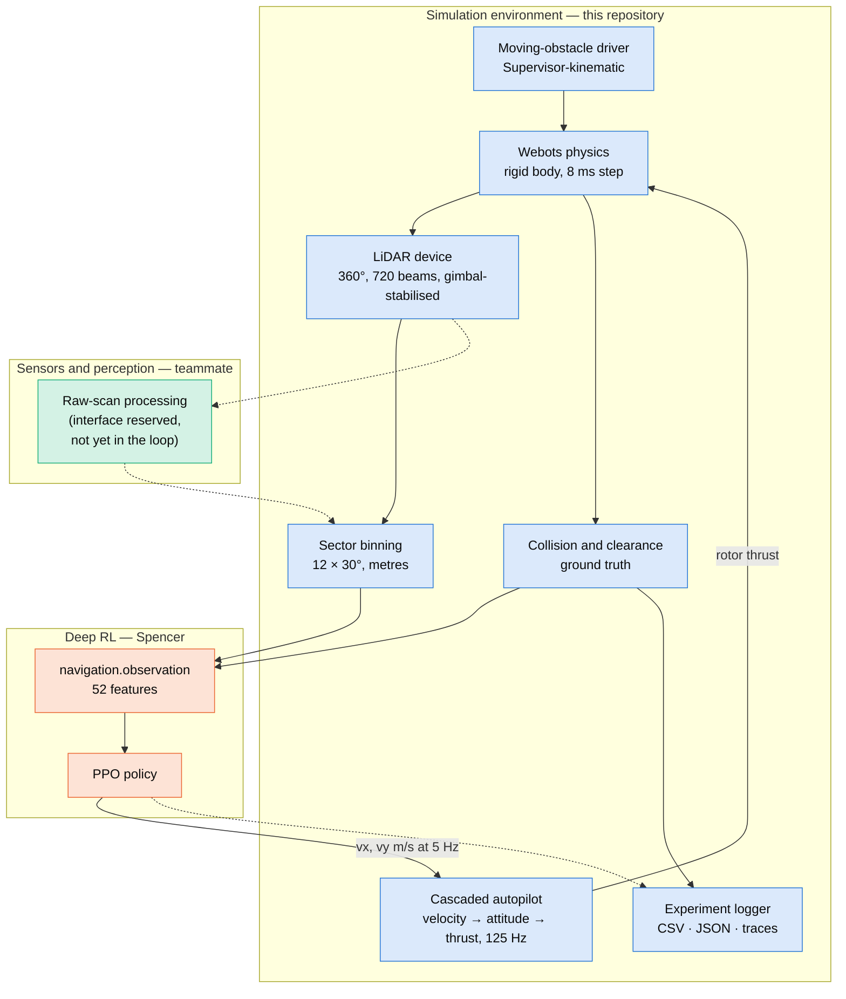
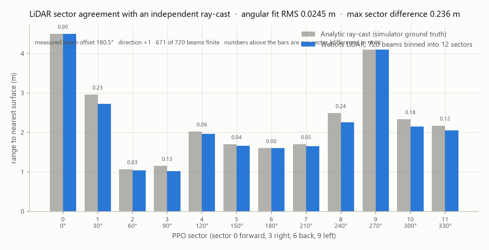
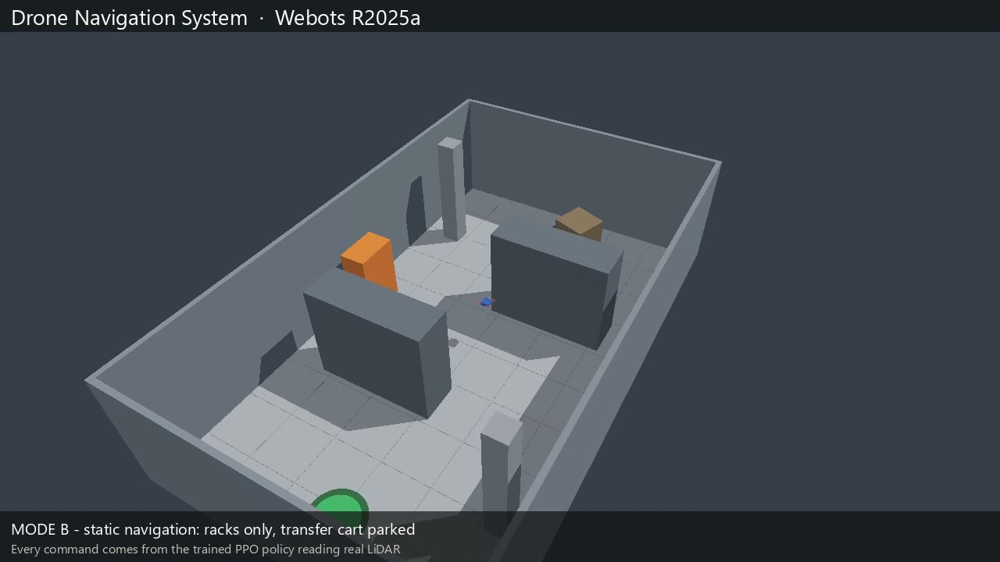

# DNS — Webots Drone Navigation Simulation

*A reproducible simulation environment for autonomous UAV navigation in static
and dynamic environments.*

**Institution** Taylor's University, Malaysia · **Supervisor** Dr. Mehdi
Samieiyeganeh · **Simulator** Webots R2025a

A simulated quadcopter must fly from a start point to a goal across an indoor
warehouse aisle without hitting anything. It perceives the world only through a
LiDAR mounted on it — it is never told where the obstacles are. Some obstacles
are fixed; one is a powered cart that crosses its route.

This repository contains the **simulation environment** for the Drone Navigation
System project: the world, the aircraft, its flight controller, the sensor
mounting, the obstacle geometry and motion, the collision ground truth, and the
interfaces that let teammates plug in. The reinforcement-learning algorithm and
the sensor-processing pipeline are owned by teammates and are **not** part of
this repository ([§4](#4-research-team-and-contributions)).


*A real Webots render of `worlds/DNS_Warehouse.wbt`, captured through the
drone's offscreen `Camera` node. Labels are placed by projecting the configured
world coordinates through the recorded camera pose — nothing in the scene was
redrawn.*

---

## 2. Project at a glance

| | |
|---|---|
| Simulator | Webots **R2025a** |
| Simulation type | rigid-body quadcopter flight, 8 ms physics step |
| Drone model | custom `DnsQuadcopter` PROTO, 0.55 kg, thrust/weight 4.00 — **not** a commercial platform |
| Environment | indoor warehouse aisle, **10.0 × 6.0 m**, 2.5 m walls |
| Flight altitude | **1.0 m**, held; fixed yaw |
| Control mode | horizontal velocity `[vx, vy]`, max **±1.2 m/s** per axis |
| Command rate | **5 Hz** (0.200000 s, error < 3e-16 s) |
| Inner control loop | 125 Hz cascaded autopilot |
| LiDAR | Webots `Lidar`, 360° horizontal, **720 beams**, 1 layer, gimbal-stabilised |
| Effective range | **5.0 m** (matches `navigation.RANGE`) |
| PPO sectors | **12 × 30°**, sector 0 forward, 3 right, 6 back, 9 left |
| Static obstacles | 2 storage racks, 2 columns, 1 crate stack |
| Moving obstacles | 1 transfer cart, 0.45 m/s across ±1.9 m |
| Verification | 46 unit tests, 22 simulator checks, 13 moving-obstacle checks — all passing |
| Experiment status | 90 episodes recorded across 2 modes and 5 controllers, **one fixed layout** |

Every value above is read from `config/scenario_warehouse.json` or a measurement
file in `results/`. Nothing here is provisional.

---

## 3. Research overview

Autonomous UAV navigation is the problem of getting an aircraft from where it is
to where it needs to be, using only what it can sense, without hitting anything.
Indoors there is no GPS-quality position fix and no map handed down in advance,
so the aircraft has to infer free space from range measurements as it flies.

Static obstacles make that a geometry problem: the free space is fixed, and a
good route exists before the drone takes off. A **moving** obstacle changes the
character of the task — the free space at a given place is now a function of
*time*, so the controller has to solve a timing problem as well as a spatial
one. That difference is the research question the wider project asks, and it is
why this environment is built in two modes that differ in exactly one factor:
whether the transfer cart sweeps the aisle or is parked against the wall.

Simulation matters here because the failure mode under study is collision. A
learned policy needs thousands of episodes including the ones that end badly,
which is not something to do with a physical aircraft. Simulation also makes
the comparison *controlled* — the same seed produces the same episode, so a
difference between two runs is attributable to the thing that was changed.

The environment exists to serve the other two workstreams: it presents the
observation contract the PPO policies were trained against, and it mounts and
configures the sensor whose raw output the perception workstream processes.

---

## 4. Research team and contributions

| Member | Research responsibility | Main deliverable / interface |
|---|---|---|
| **Dr. Mehdi Samieiyeganeh** | Research supervision, scientific direction, methodology oversight | — |
| **Khaled** | **Simulation Environment Development** — simulator selection, Webots environment, start/goal placement, static obstacle configuration, moving-obstacle development, collision geometry validation, scenario design, integration interfaces, verification and reproducibility | **This repository** |
| **Spencer** | Deep reinforcement learning — PPO training and evaluation, policy development, action/observation processing | `DroneNavPPO` package; `navigation.py` is the authoritative observation contract |
| *Sensors and perception* ⚠️ | LiDAR and depth sensing research, sensor measurement processing, observation preparation | Raw-scan processing — interface documented in [TEAM_INTEGRATION.md §B](docs/TEAM_INTEGRATION.md) |

> ⚠️ **Roster gap.** The name of the sensor and perception teammate does not
> appear in any file in this project, so the role is listed unnamed rather than
> guessed. Confirm the correct name and preferred attribution before sharing
> this repository beyond the team.

**What is mine and what is not.** This repository is the simulation environment
only. Spencer's PPO implementation and the trained checkpoints are his work and
are neither vendored nor modified here — `dns/spencer_link.py` places his
package on `sys.path` at runtime precisely so his constants cannot drift out of
sync, and his own `handoff.py` verifier is used to check our output rather than
adjusting his code to fit ours. Sensor *processing* belongs to the perception
workstream; what this repository owns is sensor *mounting and configuration*.

---

## 5. System architecture



**Data flow.** Webots advances the rigid body every 8 ms. The LiDAR renders a
360° scan, which is binned into 12 sectors in metres and passed — unnormalised —
into Spencer's `observation()`, together with the drone's measured velocity and
the relative goal vector, to form the 52-feature vector his policy expects. The
policy returns one horizontal velocity command every 0.2 s; the autopilot holds
that command while closing three nested loops at 125 Hz, and the resulting rotor
thrust is what actually moves the aircraft. Nothing writes the drone's position
directly. In parallel, the Supervisor drives the transfer cart along its
kinematic path, and a separate ground-truth routine computes collision and
clearance from true geometry rather than from the sensor, so measured and true
clearance can be compared.

The dashed path is the documented but **not yet integrated** handoff to the
perception workstream: today the simulator bins the raw scan itself.

---

## 6. Simulation environment


*Drawn directly from `config/scenario_warehouse.json` — the same file that
generates the Webots world — so the plan cannot drift from the simulated
geometry.*

| | |
|---|---|
| Type | indoor warehouse inspection aisle |
| Extent | `low_xy = [0.0, −3.0]` → `high_xy = [10.0, 3.0]`, **10.0 × 6.0 m** |
| Walls | 2.5 m high, 0.1 m thick; 1 m floor grid |
| Frame | DNS: **+x forward, +y right**; Webots is ENU, mapped `y_dns = −y_webots` |
| Altitude | 1.0 m held, yaw fixed at 0 rad |
| Start | (0.85, 0.00) m |
| Goal | (9.15, 0.00) m, success within **0.40 m** |

The 10 × 6 m extent is deliberate: the PPO checkpoints were fitted on exactly
that workspace, so enlarging the room would move the goal feature outside the
distribution they saw and confound any comparison. Walls were raised from 1.2 m
to 2.5 m because at 1.2 m only 0.125 m of wall stood above the scan plane and
tilt beyond ~6° sent beams over the top, reporting open space where a wall
stood. Both decisions are argued in full in
[SIMULATION_METHODS.md §4](docs/SIMULATION_METHODS.md).

| Obstacle | Footprint | Height | Role |
|---|---|---|---|
| `rack_a` (3.50, −1.00) | 0.8 × 2.4 m | 2.0 m | forces the first lateral deviation; flat face is the LiDAR calibration target |
| `rack_b` (6.50, +1.00) | 0.8 × 2.4 m | 2.0 m | forces a second deviation the other way |
| `column_1` (2.00, +2.30) | 0.4 × 0.4 m | 2.5 m | off-route column; known square return for calibration |
| `column_2` (8.00, −2.30) | 0.4 × 0.4 m | 2.5 m | mirror column, late in the route |
| `crate_stack` (7.90, +0.90) | 0.7 × 0.7 m, yaw 0.35 rad | 1.6 m | clearance test on the final approach |
| `cart` (5.10, 0.00) | 0.9 × 0.55 m | 1.5 m | **moving** — see §7 |

Full coordinates, justifications and navigability margins:
[SIMULATION_METHODS.md §5](docs/SIMULATION_METHODS.md).

---

## 7. Static and moving obstacles

The two racks exist to make the scene **discriminative**. An earlier layout kept
them 0.30 m clear of the straight start-to-goal line, and a baseline that simply
flies at the goal threaded the gap and scored 3/3 — so the static condition
measured nothing. Each rack now overlaps y = 0 by 0.20 m; after inflating by the
drone's 0.18 m radius, passing `rack_a` requires y ≥ +0.38 m and passing
`rack_b` requires y ≤ −0.38 m, forcing an S-shaped route. The columns and crate
stack add off-route hazards and precisely known calibration returns.

The transfer cart is the dynamic hazard:

| Property | Value |
|---|---|
| Motion | `linear` — constant-speed back-and-forth along the y axis |
| Amplitude | ±1.90 m about y = 0, at x = 5.10 m |
| Speed | **0.45 m/s** (measured median 0.4500 m/s) |
| Period | T = 4A/v = **16.889 s** |
| Initial phase | per-seed, `default_rng(seed).uniform(0, 2π)` |
| Repeatability | replays across resets to **2.554e-15 m** |
| Collision | exact rectangular footprint, swept against the drone's 0.18 m disc |

Because it crosses perpendicular to the direction of travel, the free space at
x = 5.1 m is a function of time and the controller must solve a timing problem
rather than a purely geometric one.

> **This motion is kinematic, not rigid-body.** The Supervisor writes the cart's
> pose each step from its motion equation. The cart cannot be pushed, pushes
> nothing, and carries no momentum. That buys exact repeatability — which is
> what makes the static-versus-dynamic comparison meaningful — at the cost of
> contact realism. It should not be described as physical simulation of a
> vehicle.


*13/13 checks over 90 control steps. The top panel agrees to 0.000e+00 m **by
construction** — the cart is driven from that equation — so it verifies the
implementation, not physical fidelity. The independent evidence is the bottom
panel: the measured scan against a separately implemented analytic ray-cast of
the same moving scene, occlusion included.*

---

## 8. Drone and simulator specifications

The aircraft is a **custom research PROTO** (`protos/DnsQuadcopter.proto`) built
only from Webots base nodes, so a world loads with no network access and no
`EXTERNPROTO` download.

> **It does not represent a physical platform.** This is not a Crazyflie, a
> Mavic, or any commercial airframe, and no claim is made about a real
> flight-controller board, microcontroller or physical sensor. Accordingly no
> manufacturer photograph appears in this repository — every image here is
> genuine output of this project.

| Property | Value |
|---|---|
| Model | `DnsQuadcopter`, X configuration |
| Mass | 0.55 kg (0.35 kg body + 4 × 0.05 kg rotor groups) |
| Inertia | Ixx = Iyy = 0.00272, Izz = 0.00513 kg·m² |
| Arm offset | 0.09 m → tip radius 0.1773 m |
| Collision radius | **0.18 m**, matching `navigation.RADIUS` |
| Propulsion | 4 × Webots `Propeller`, t₁ = 1.5e-05 N·s², q₁ = 2.4e-07 N·m·s² |
| Hover / max thrust | 1.3489 N per rotor / 5.4 N at 600 rad/s |
| Thrust-to-weight | **4.003** (measured) |
| Linear damping | 0.695 s⁻¹ (measured, rotors-off terminal velocity 14.11 m/s) |
| Max tilt | 0.45 rad ≈ **25.78°** |
| Control interface | `<extern>` controller; horizontal velocity at 5 Hz |
| Simulated sensors | `Lidar`, `GPS`, `Gyro`, `InertialUnit`, optional `Camera` (1280 × 720) |
| Dependencies | Python 3.11+, `numpy`; Webots supplies `controller` |

Two parameters are deliberately non-physical and are declared as such:
`motorMaxTorque` = 2000 N·m is a spin-up rate knob, not a motor rating, and the
rotor helices are graphical only. Both are explained, with the measurements that
forced them, in [SIMULATION_METHODS.md §7](docs/SIMULATION_METHODS.md).

---

## 9. Sensor and PPO compatibility

**PPO interface** — the backend implements Spencer's `Backend` protocol, so it
drops into `Navigation` unchanged:

| | |
|---|---|
| Action | horizontal velocity `[vx, vy]` in m/s, already scaled |
| Limit | ±1.2 m/s per axis (`navigation.SPEED`); exceeding raises `BackendError` |
| Interval | 0.200000 s = 25 × 8 ms, **5 Hz** |
| Frame | +x forward, +y right, altitude 1.0 m, yaw 0 |
| Feedback | `velocity` is **measured** from GPS, not the command echoed back |
| Observation | 52 features, built by Spencer's own `observation()` |
| Reset | restores pose, obstacles and phase; repeats to 2.758e-06 m |
| Termination | exactly one of `goal` / `collision` / `timeout`, horizon 90 steps |

**LiDAR interface:**

| | |
|---|---|
| Scan | 360° horizontal, `projection "cylindrical"` |
| Beams | **720** (0.5°, 60 per sector), **1 layer**, zero noise |
| Range | 0.05 – **5.0 m** cap |
| Sectors | 12 × 30°; **0 forward, 3 right, 6 back, 9 left**, clockwise |
| Angular mapping | **measured**: direction +1, offset 180.50°, RMS 0.0245 m |
| Encoding | `(d, True)` seen · `(5.0, True)` observed-clear · `(0.0, False)` unobserved |
| Timestamps | simulation seconds since reset; two-frame packets exactly 0.200000 s apart |

The simulator provides the environment and the raw measurements. It does **not**
implement the PPO algorithm or the sensor-processing pipeline. Detailed
contracts, worked examples, calibration commands and the known failure modes to
design against: **[TEAM_INTEGRATION.md](docs/TEAM_INTEGRATION.md)**.

---

## 10. Evaluation and verification

Software verification — *does the simulator do what it claims* — is reported
separately from research evaluation — *how does a controller behave in it*.

| Category | Test | Measured result | Tests | Status | Evidence |
|---|---|---|---|---|---|
| Flight is physical | rotor thrust only, nothing teleports | commanded 1.2 m/s reads **0.2801 m/s** after one 0.2 s step | 1 | PASS | `results/validation_physical_lidar.json` |
| Coordinates | all four commanded directions | +x → `[0.4657, 0.0]`, +y → `[−0.0002, 0.4657]` m | 4 | PASS | same |
| Command timing | 5 Hz contract | max error **2.78e-16 s** | 2 | PASS | same |
| Velocity feedback | measured, not echoed | measured ≠ commanded throughout | 1 | PASS | same |
| Collision geometry | exact footprints + walls | fires at `[0.255, 0.0]`; no false positive at start | 2 | PASS | same |
| Reset repeatability | same seed, same episode | **2.758e-06 m**; 3-command trajectory to 7.091e-03 m | 2 | PASS | same |
| PPO handoff | Spencer's own verifier | `navigation.validate` accepts every frame; obs shape (52,) | 4 | PASS | same |
| LiDAR angular mapping | fitted against known geometry | direction +1, offset **180.50°**, RMS **0.0245 m** | — | PASS | `results/calibration_warehouse.json` |
| Sensor consistency | scan vs independent ray-cast | mean **0.0475 m**, worst 0.2900 m over 90 steps × 12 sectors | 1 | PASS | `results/moving_obstacle_warehouse.json` |
| Obstacle trajectory | path, speed, replay | speed **0.4500** vs 0.45 configured; replay **2.554e-15 m** | 13 | PASS | same |
| Scenario & geometry | pure-function suite | — | 46 | PASS | `tests/unit_tests.py` |

**Totals: 46 unit tests, 22 simulator checks, 13 moving-obstacle checks — all
passing.** Full tables, methodology and the class of each claim (measured /
ground truth / exact by construction / derived) are in
**[VALIDATION_EVIDENCE.md](docs/VALIDATION_EVIDENCE.md)**.

### Research evaluation — 90 episodes

Five controllers across two modes. **Three are trained PPO checkpoints; two are
hand-written scripted baselines** (`evaluate.gap_rule` and `evaluate.go_to_goal`)
included as a sanity floor, not as competing methods.

| Mode | PPO seed 7 | PPO seed 19 | PPO seed 43 | reactive (scripted) | goal-direct (scripted) |
|---|---|---|---|---|---|
| B static (3 ep. each) | 3/3 | 3/3 | 3/3 | 0/3 — 3 timeouts | 0/3 — 3 collisions |
| C dynamic (15 ep. each) | 9/15 (60.0%) | 8/15 (53.3%) | 7/15 (46.7%) | 0/15 — 5 collisions, 10 timeouts | 0/15 — 15 collisions |

No episode was excluded; every rate is successes ÷ episodes in that cell.

---

## 11. Key figures and results


*Moving the cart drops PPO goal-reaching from 3/3 to roughly half, and the
failures become collisions rather than timeouts — the environment discriminates
between the two conditions. The intervals overlap heavily: with 3 episodes per
static cell and 15 per dynamic cell, **this does not rank the three seeds
against each other**, and the untuned baselines are a floor, not a comparison.
Data: `results/experiments_warehouse/experiment_summary.csv`.*


*Recorded paths, including the episodes that failed. The S-shape is the layout
working as designed. The goal-direct baseline collides with `rack_a` at
x ≈ 2.9 m, and the reactive rule stalls because its fixed 1.45 m repulsion
radius exceeds the 1.54 m crate-to-goal distance — a statement about an untuned
constant, not about reactive navigation.
Data: `results/experiments_warehouse/traces.json`.*



*The angular mapping was **measured**, not assumed — fitting against known arena
geometry gives offset 180.50° with an RMS residual of 0.0245 m, one beam pitch.
Worst single-sector disagreement is 0.236 m, a boundary graze.
Data: `results/calibration_warehouse.json`.*

Raw per-episode data: `results/experiments_warehouse/experiment_results.csv`
(90 rows). All figures are regenerated by `python scripts/make_assets.py`, with
sources recorded in `assets/ASSET_PROVENANCE.json`.

---

## 12. Demonstration video

[](assets/demo-thumbnail.jpg)

**Demonstration video — hosted link pending.**
`results/demo/DNS_Webots_Research_Demo.mp4` · 1280 × 720 · 25 fps · 1255 frames
· **50.2 s** · verified `VALID` by `scripts/verify_mp4.py` (1028 distinct frame
sizes, so the capture is not static or blank).

Every frame is a real Webots render of a real run, captured through an in-scene
`Camera` node — Webots' own screen recorder produces blank frames in this
automated setup ([VALIDATION_EVIDENCE.md §8.7](docs/VALIDATION_EVIDENCE.md)).
Playback is 1:1 with simulation time; no frames are duplicated or stretched.

**What it records,** flown by PPO checkpoint seed 19 across 8 segments:

| Segments | Scenario | Outcome |
|---|---|---|
| 1–2 — environment and start/goal overview | — | — |
| 3–4 — static navigation, overview and top-down | `warehouse_static` | **goal reached**, 37 steps / 7.4 s, stopping 0.157 m from the goal |
| 5 — crossing-obstacle introduction | — | — |
| 6–7 — dynamic navigation, overview and low angle | `warehouse_dynamic` | **collision** in both, after 21 steps / 4.2 s at x ≈ 5.4 m, 3.7 m short of the goal |
| 8 — final state | — | — |

> The recording is **not** a clean success reel. Its two dynamic segments both
> end in a collision with the transfer cart. That is the characteristic failure
> this environment was built to expose, and it is left in deliberately.

---

## 13. Quick start

Verified on Windows 10 with Webots R2025a and Python 3.15.2.

```bash
# 1. dependencies
pip install -r requirements.txt

# 2. set WEBOTS_HOME only if Webots is not auto-detected
#    PowerShell:  $env:WEBOTS_HOME = "D:\Program files\Webots"

# 3. checks that need no simulator at all -- 46 tests, a few seconds
python tests/unit_tests.py
```

**Core simulator setup** — open `worlds/DNS_Warehouse.wbt` in Webots. The
drone's controller is `<extern>`: Webots loads the scene and then **waits** for
a Python program to connect and fly it, so a motionless drone is expected. Drive
it with:

```bash
python scripts/with_webots.py --timeout 420 --world worlds/DNS_Warehouse.wbt \
    tests/client_validation.py -- --config config/scenario_warehouse.json \
    --dynamics physical --sensing lidar        # expect 22/22
```

Regenerate a world after editing `config/*.json` or the PROTO — worlds are
generated, so hand-edits are overwritten:

```bash
python -m dns.worldgen --config config/scenario_warehouse.json \
    --out worlds/DNS_Warehouse.wbt
```

### Optional — PPO integration

Needs Spencer's package, which is **not on PyPI and is not vendored here**. Place
`DroneNavPPO/` beside this repository, or set `DNS_PPO_DIR` to the directory
containing `navigation.py`. The 90-episode experiment additionally needs his
trained checkpoints (`evidence/seed*/model.npz`), which are his to share:

```bash
python scripts/with_webots.py --timeout 3000 --world worlds/DNS_Warehouse.wbt \
    tests/client_experiments.py -- \
    --dynamic-config config/scenario_warehouse.json \
    --static-config  config/scenario_warehouse_static.json \
    --out results/experiments_warehouse
```

`tests/unit_tests.py` is the only suite that runs without his package. Full
reproduction recipe for every figure, table and video:
[VALIDATION_EVIDENCE.md §8](docs/VALIDATION_EVIDENCE.md).

---

## 14. Project structure

```text
config/      scenario definitions -- the single source of truth for geometry
dns/         the simulation package
  scenario.py    config loading, validation, DNS <-> Webots transform
  worldgen.py    writes .wbt worlds from a scenario JSON
  backend.py     implements Spencer's navigation.Backend protocol
  autopilot.py   cascaded velocity -> attitude -> rotor-thrust controller
  sensing.py     12 x 30 deg sector sensing (none / lidar / geometric)
  launcher.py    starts Webots, prepares the <extern> controller environment
  spencer_link.py  locates and imports Spencer's PPO package
protos/      DnsQuadcopter.proto -- airframe, rotors, sensor mounts
worlds/      generated Webots worlds (files prefixed "_" are the retained
             physics-bisection ladder, not deliverables)
controllers/ small in-simulator diagnostic controllers
tests/       unit_tests.py runs standalone; client_*.py run against Webots
scripts/     harness, asset/figure/report generators, MP4 verifier
results/     raw measured output -- the provenance behind every claim
assets/      README figures, annotated screenshots, ASSET_PROVENANCE.json
docs/        the three technical documents plus the sensor-attitude study
evidence/    payloads assembled into the supervisor/Drive bundle by
             scripts/build_deliverable.py -- not separate documentation
```

---

## 15. Limitations and future work

Read this before quoting any result.

1. **One fixed obstacle layout.** Mode C varies *when* the cart arrives, not
   *where* obstacles are. Nothing here supports a spatial-generalisation claim.
   Randomised layouts are **future work, not implemented**.
2. **Small samples.** Three episodes per static cell; a 3/3 result carries a 95%
   interval of 43.9–100%.
3. **Three checkpoints**, whose dynamic spread (46.7–60%) is as wide as the
   effect being measured.
4. **Untuned baselines** — a sanity floor, not a ranking of methods.
5. **Idealised LiDAR stabilisation** — the gimbal is massless, with no lag and
   no joint limits. Real stabilisation has all three.
6. **One scan layer**, so the sensor is blind to anything not crossing 1.14 m;
   the validator now rejects obstacles shorter than the scan plane.
7. **Kinematic obstacle motion** — no contact dynamics (§7).
8. **Fixed altitude and yaw** — the problem is solved in the horizontal plane.
9. **Zero sensor noise** — noise belongs in a deliberate robustness study.
10. **PPO training distribution** — the arena is held at 10 × 6 m because the
    checkpoints were fitted there. A larger hall is a legitimate
    out-of-distribution study and must be reported as one.
11. **No real-world validation.** No physical drone was flown; simulation
    results do not transfer without a separate study.

Planned next: randomised obstacle layouts, an out-of-distribution arena study,
deliberate sensor noise, and integration of the perception workstream's
processing into the live loop.

---

## 16. Research documents

| Document | What it covers |
|---|---|
| **[Simulation methods](docs/SIMULATION_METHODS.md)** | Design and verification of the environment: simulator choice, geometry, coordinate conventions, obstacle models with equations, drone model, control, timing, collision geometry, reproducibility |
| **[Team integration](docs/TEAM_INTEGRATION.md)** | PPO interface for Spencer and the LiDAR interface for the perception workstream, with worked examples and flagged interface changes |
| **[Validation and evidence](docs/VALIDATION_EVIDENCE.md)** | Every verification result with its evidence file, the 90-episode experiment, limitations, and the full reproduction recipe |
| [Sensor attitude study](docs/SENSOR_ATTITUDE.md) | Stabilised versus body-fixed mount — the measurement behind the configured default |
| Demonstration video | hosted link pending |

---

## 17. Research use and attribution

This is university research conducted at Taylor's University under the
supervision of Dr. Mehdi Samieiyeganeh. The repository is **private** and is
shared with the supervisor and authorised team members for research purposes.

Reuse, redistribution or publication is subject to the permissions of the
project and the institution. **No open-source licence is granted here**, and
none should be inferred from the presence of this file. The Apache-2.0 header
inside `protos/DnsQuadcopter.proto` reflects the Webots PROTO template
convention it was derived from and is not a licence grant for this project as a
whole.

This repository covers the **Simulation Environment Development** contribution
only. The PPO implementation and trained checkpoints are Spencer's work; sensor
processing belongs to the perception workstream. Neither is claimed here, and
the wider DNS project is a team effort rather than the independent work of any
one member.
