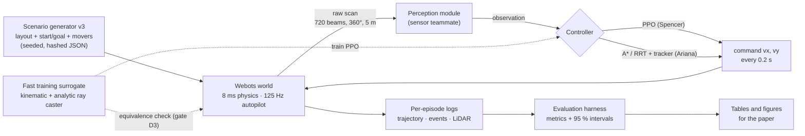

# Research plan: LiDAR-only UAV navigation among moving obstacles, benchmark phase

**From:** 28 Nov 2026. **Benchmark:** Wang, Zhou & Wu, *IEEE Transactions on Vehicular Technology* (2026). See [BENCHMARK_TVT2025](benchmark/BENCHMARK_TVT2025.md).
**Direction:** the supervisor. **Owners:**

| Work package | Owner |
|---|---|
| WP-ENV, WP-EVAL | Khaled |
| WP-PPO | Spencer |
| WP-SENS | the sensor teammate |
| WP-BASE | Ariana |

**Target:** a journal paper in a Q1 venue.

This plan builds on what is already verified in this repository. Each work package has a *done when*. Nothing here is a result yet.

---

## 1. Research question

> Can a PPO policy that sees only a 360° 2D LiDAR fly a quadrotor in Webots to **randomly placed goals** among **several moving obstacles**? Can it do so robustly to **sensing uncertainty** and on **unseen layouts**? And how does it compare with traditional planners, and with the benchmark under its own protocol?

### Hypotheses (each tested by an experiment in §5)

| | Hypothesis | Experiment |
|---|---|---|
| **H-a** | A temporal LiDAR encoding (stacked frames or a recurrent layer) raises success among moving obstacles compared with a single frame. | E5 |
| **H-b** | Randomising LiDAR noise and dropout in training raises robustness without lowering nominal success. | E3 |
| **H-c** | Training on random start and goal pairs carries over to held-out pairs and layouts. | E1, E2 |
| **H-d** | Compared with replanning A\* and RRT, PPO has fewer collisions in dynamic scenes, while the planners give shorter paths in static scenes. | E1 |

---

## 2. Pipeline

**Two loops.**

- **Evaluation** always runs in Webots, which is the high-fidelity world.
- **Training** can run in a fast surrogate, because PPO needs far more episodes than Webots can produce quickly. The candidates are:
  - Spencer's existing training environment;
  - a kinematic copy built on `dns.sensing.cast_rays`, the analytic ray caster already validated against the Webots LiDAR.

  Whichever passes gate D3 is used.

---

## 3. Interfaces (contracts to agree first)

| Contract | Version | Owner | Content |
|---|---|---|---|
| Scenario | v3 | Khaled | v2 plus `start_goal`: a sampling rule (region, minimum distance, clearance) or a fixed pair; plus `movers`: a list of {shape, size, motion model, speed, phase}. Seeded and hashed as now. |
| Sensor | v3 | sensor teammate | Input: the raw 720-beam scan, timestamp and attitude. Output 1, kept for compatibility: the 12-sector (range, valid) pairs that `pack_scan` produces now. Output 2: an extended representation (for example 36 or 72 minimum-range bins, motion cues, per-bin validity or uncertainty). |
| Policy | v3 | Spencer | Observation layout and normalisation; action = 2 floats in [−1, 1] × 1.2 m/s, every 0.2 s (unchanged). |
| Evaluation record | v3 | Khaled | Today's per-episode fields (outcome, steps, path efficiency, minimum clearance, near misses), plus start/goal, the mover set, the noise setting and the controller version. |

**Rule:** a contract changes only by pull request, with a version bump, a contract test, and the agreement of everyone it affects.

---

## 4. Work packages

### WP-ENV: dynamic worlds (Khaled)

1. **Pass the strict reset gate.** The deterministic reset currently misses it on 1 of 5 targets (see [Reset reproducibility](../README.md#reset-reproducibility-two-cohorts-kept-apart)). Training data meant for publication waits for this.
2. **Dynamic start and goal.** Sample a pair per episode from the seed. The pair must meet all of these:
   - both points are in free space;
   - clearance to every obstacle is at least 0.18 m plus a margin;
   - the points are a minimum distance apart;
   - A\* finds a path;
   - the straight line is blocked in some of the episodes, so the task does not collapse to "fly straight".

   Store the pair in each run manifest. Freeze a held-out set of pairs for testing.
3. **Several movers.** Add carts and pedestrian-like bodies, all taller than the 1.14 m scan plane so that they cross it, with these motion models: back-and-forth (today's), random waypoint, and crossing the drone's corridor.
   - **Evaluation:** scripted and seeded.
   - **Training:** stochastic.
4. **Benchmark-matched scenes.** After the PDF is read, build Webots versions of the benchmark's scenario types.
5. **Training surrogate** (with Spencer). Build the kinematic environment and run the equivalence test for gate D3.

**Done when:** scenario v3 is generated, validated and hashed for all families; contract tests pass; the layout gate confirms every test scene is passable.

### WP-SENS: LiDAR processing (the sensor teammate)

1. **Plug in at the existing swap point.** This is `dns/sensing.lidar_scan` (see *Plugging in your processing* in the [sensor guide](team/FOR_SENSOR_TEAM.md)). Keep output 1 in the 12-sector encoding that `navigation.pack_scan` produces today, so the current PPO still runs.
2. **Extended representation (output 2).** Finer bins, and motion cues from consecutive scans such as frame differences or clustered moving returns, with per-bin validity.
3. **Uncertainty model** for training and for robustness tests:
   - Gaussian range noise;
   - beam dropout;
   - fewer usable returns at range;
   - a body-fixed mount that tilts with the drone, instead of today's ideal gimbal.
4. **Validation against ground truth.** Use the 60 runs with `lidar.npz` and `scripts/analyse_lidar_cart.py`. Report sector error, whether the cart is detected, and latency.

**Done when:** sensor v3 passes its contract test, matches today's sectors on the logged runs (output 1), and comes with a documented noise model and its parameters.

### WP-PPO: an improved policy (Spencer)

1. **Document the current baseline** in this repository: reward terms, network size, training budget, seeds.
2. **Observation.** Use the sensor v3 extended representation. Keep relative goal (distance, bearing) and own velocity. Add temporal context by frame stacking (k = 3–4) or a recurrent layer (H-a).
3. **Training.**
   - Random start and goal, and several movers.
   - A curriculum: static scenes, then slow movers, then fast and multiple movers.
   - Domain randomisation of the LiDAR noise model (H-b).
4. **Candidate improvements**, each kept only if an ablation shows it helps:
   - a critic that sees privileged ground truth, such as true obstacle states, during training only;
   - a reward term on clearance (the 0.30 m near-miss band);
   - a LiDAR-based safety shield that vetoes unsafe commands, reported both with and without.
5. **Seeds.** Train at least 5 seeds for every variant.

**Done when:** the variants are trained, checkpoints are hashed, and each variant is evaluated in Webots by the harness, never by its own training scripts.

### WP-BASE: traditional baselines in Webots (Ariana)

1. **Port the planners** from the [2D prototype](../baselines/traditional/README.md) to the scenario geometry:
   - A\* (8-connected) and RRT with 10 % goal bias;
   - a 0.05 m grid, inflated by 0.18 m plus a margin;
   - optionally RRT\* and one reactive planner (APF or DWA).
2. **Two information settings:**
   - an oracle static map (upper bound);
   - LiDAR-only replanning every 0.2 s (the same information as PPO).
3. **Fly the plans** with the existing reference tracker under the same command interface and speed limit as PPO.

**Done when:** both planners run on every v3 scenario family through the evaluation harness, with at least 30 episodes per configuration.

### WP-EVAL: one harness, one standard (Khaled, used by all)

- **One harness** runs every controller: PPO variants, baselines, and the benchmark method if it is re-implemented.
- **Metrics are kept from v2:**
  - outcome: goal, collision (static, cart, wall) or timeout;
  - path efficiency (A\* length ÷ flown length);
  - minimum clearance;
  - near misses (clearance < 0.30 m);
  - steps to goal.
- **New metrics:** smoothness (mean |Δ command|) and inference time per step.
- **Statistics:** Wilson 95 % intervals for rates; bootstrap intervals for continuous metrics; no ranking without separated intervals.
- **Provenance:** every published number gets a row in `evidence/CLAIMS_EVIDENCE.csv`.

---

## 5. Experiment matrix

| | Question | Factors | Size |
|---|---|---|---|
| **E1** Main comparison | Which controller is safest and most efficient? | Controllers: PPO v2 (today), PPO v3 variants, A\*, RRT (10 % goal bias), optional APF/DWA. Scene families: static, one mover, several movers, benchmark-matched. Start/goal: fixed, random, held-out. | ≥ 100 episodes per cell; 5 seeds per PPO variant |
| **E2** Generalisation | Do policies transfer to unseen layouts? | Held-out layouts by IoU band, the mirror, the hardest layout; held-out start/goal pairs | as E1 |
| **E3** Sensing robustness | How does success degrade with LiDAR uncertainty? | Range noise σ; dropout rate; body-fixed tilt on or off | Sweep of ≥ 4 levels per factor |
| **E4** Dynamic difficulty | Where does avoidance break? | Mover speed; mover count; motion model, including speeds outside training | Sweep |
| **E5** Ablations | Which PPO changes matter? | Temporal encoding; privileged critic; curriculum; safety shield; clearance reward | One change at a time |
| **E6** Simulation fidelity | Is training in the surrogate valid? | Surrogate vs Webots, same policies and scenes | Outcome agreement and sector error |

The noise levels, speeds and counts are set once the benchmark's own ranges are known [PDF], so that our sweeps cover theirs.

---

## 6. Decision gates

| Gate | When | Passes if |
|---|---|---|
| **D1** | after the benchmark PDF is read | the comparison mode is chosen: protocol-matched or re-implementation (see [benchmark §6](benchmark/BENCHMARK_TVT2025.md#6-how-we-will-compare-fairly)) |
| **D2** | before training data is used for publication | the deterministic reset meets the strict order-independence gate on every target |
| **D3** | before large-scale surrogate training | the surrogate agrees with Webots on the logged runs. Proposed thresholds: sector error ≤ 0.05 m, comparable to the 0.048 m LiDAR-vs-ray-caster agreement; outcome agreement ≥ 90 % on a fixed test set. To be agreed by the team. |
| **D4** | before the L04 result is used | the supervisor decides: keep L04 excluded, or run a longer-horizon diagnostic |

---

## 7. Timeline (relative weeks; dates set at the next team meeting)

| Week | Khaled (ENV, EVAL) | Sensor teammate (SENS) | Spencer (PPO) | Ariana (BASE) |
|---|---|---|---|---|
| 0 | Fill the benchmark extraction sheet; gate D1; agree the v3 contracts | Agree sensor v3 | Document the current PPO; agree policy v3 | Plan the port |
| 1–2 | Reset gate D2; scenario v3 (start/goal, movers) | Output 1 and the noise model | Surrogate with Khaled; gate D3 | A\* and RRT on the v3 geometry |
| 3–5 | Harness v3; benchmark-matched scenes | Output 2 (extended) | PPO v3 variants, 5 seeds each | LiDAR replanning; tracker runs |
| 6–7 | Run E1–E6 | Robustness sweeps (E3) | Ablations (E5) | Baseline runs (E1) |
| 8–10 | Paper: environment, method, evaluation | Paper: sensing | Paper: learning | Paper: baselines |

---

## 8. Paper outline (draft)

- **Working title:** LiDAR-only PPO navigation for quadrotors among moving obstacles with randomised goals: a verified Webots study.
- **Candidate contributions.** We claim only those the experiments support.
  1. A verified, reproducible Webots environment with moving obstacles, randomised start and goal, hashed scenarios and a public evaluation harness.
  2. An improved PPO for 360° LiDAR input, with temporal encoding and uncertainty-aware training (E5 shows which parts matter).
  3. A comparison with traditional planners under identical sensing, and with the benchmark under its protocol, with intervals and out-of-distribution tests (E1, E2).
  4. A robustness analysis to LiDAR uncertainty and to simulation fidelity (E3, E6).
- **Not claimed:** real-world flight performance. No claim of "first" before a literature review, and no claim of beating the benchmark unless both methods ran under the same protocol.
- **Venues to consider:** IEEE TVT (the benchmark's journal), IEEE RA-L, IEEE T-ITS, *Drones*. Check each venue's current quartile before submission.

---

## 9. Risks

| Risk | Mitigation |
|---|---|
| Webots is too slow for PPO training | train in the surrogate (gate D3); use Webots for evaluation |
| The benchmark PDF stays unavailable | request it from the authors or the library; meanwhile compare on our own protocol and state that the benchmark's numbers are not reproduced |
| Reset residual state contaminates training | gate D2 before any publication data |
| Overfitting to the training layout | held-out layouts, pairs and mover settings, frozen before training |
| Teammate code leaves no trace in this repository | interfaces and SHA-256 fingerprints recorded, as for the current checkpoints |
