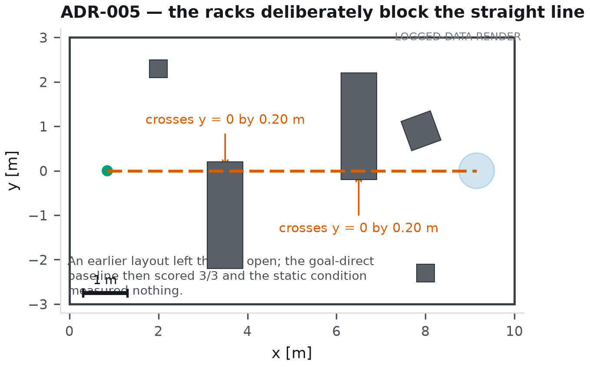

# ADR-005 — The racks deliberately cross the straight start-goal line

**Status:** Accepted

Figure — evidence for ADR-005 · LOGGED-DATA RENDER · source: `assets/decisions/ADR-005_line_block.png`

## Context
An earlier v1 layout left the straight line from start to goal open by 0.30 m.
The goal-direct baseline then threaded the gap and scored 3/3, so the static
condition measured nothing at all.

## Options considered
1. Leave the line open and rely on the moving cart for difficulty.
2. Make each rack cross the centre line by a controlled depth.

## Decision
**Every layout blocks the straight line.** In L00 each rack crosses y = 0 by
0.20 m; the generator enforces a minimum crossing depth of 0.12 m in every
generated layout and records the realised depth as a descriptor.

## Evidence
`tests/test_generator.py::every layout blocks the straight start-goal line`
checks all six. Realised intrusion depths are in
`results/v2_S6/scenario_table.csv`. `direct` scores 0 in Mode B on every
layout, which is the behaviour this decision is meant to produce.

## Consequences
+ The static condition is discriminative on its own, without the cart.
− `direct` can never succeed, so it is a floor reference rather than a baseline.

---

**Related:** ADR-009 · [ADR index](README.md) ·
[decision log](DECISIONS_LOG.md)
