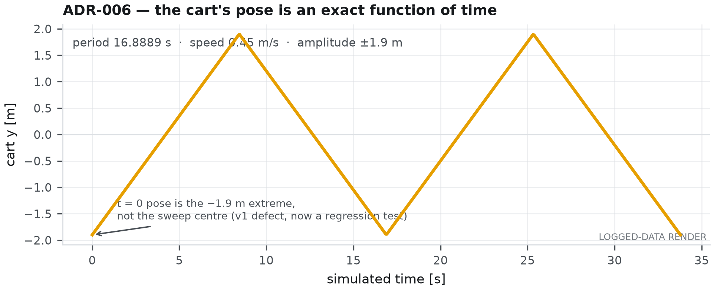

# ADR-006 — The cart is kinematic

**Status:** Accepted with a stated limitation

Figure — evidence for ADR-006 · LOGGED-DATA RENDER · source: `assets/decisions/ADR-006_cart_spacetime.png`

## Context
The dynamic hazard has to be exactly reproducible for a given seed, so that two
runs of the same configuration are comparable.

## Options considered
1. Kinematic: write the cart's pose from a closed-form function of time.
2. Physical: give the cart a `Physics` node and drive it with a motor.

## Decision
**Kinematic.** `Obstacle.centre_at(t)` is a pure function of simulated time, so
the cart's trajectory is identical in every run with the same phase.

## Evidence
The t = 0 pose is the −1.9 m extreme of the sweep, **not** the sweep centre —
a v1 world-file defect that put the cart 1.9 m from where the model said it was
and corrupted a calibration reference by 1.34 m. It is now asserted at build
time for every body in every world (`scripts/build_worlds.py`), at run time by
`dns/worldcheck.check`, and as a unit test.

## Consequences
+ Exact reproducibility; the period is 16.8889 s at 0.45 m/s over +-1.9 m.
− **Webots reports no rigid-body velocity for the cart, so physical contact
  response with it is not modelled.** A `collision_cart` outcome means the swept
  footprints intersected, not that an impact was simulated. A real cart would
  push the drone. Stated wherever cart collisions are reported.
− "Cart pose vs its own motion model = 0" is true by construction and is
  therefore an implementation-consistency check, never evidence (see C2).

---

**Related:** ADR-012 · [ADR index](README.md) ·
[decision log](DECISIONS_LOG.md)
