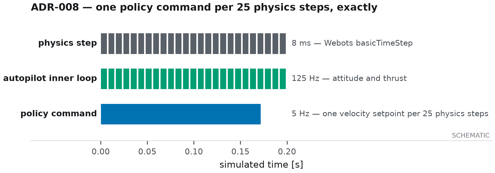

# ADR-008 — 5 Hz velocity commands over a 125 Hz loop and an 8 ms step

**Status:** Accepted

Figure — evidence for ADR-008 · LOGGED-DATA RENDER · source: `assets/decisions/ADR-008_timing_ladder.png`

## Context
Three clocks have to nest exactly: Spencer's contract fixes one observation
every `DT = 0.2 s`; a quadrotor cannot track a velocity step instantly, so it
needs a fast inner attitude loop; and Webots advances in fixed `basicTimeStep`
increments.

## Options considered
1. Command the rotors directly at the policy rate.
2. A cascaded autopilot: velocity -> tilt -> rotor thrust, with the policy
   setting only the outer velocity setpoint.

## Decision
**Cascaded, with an 8 ms physics step.** 0.2 s is exactly 25 steps of 8 ms, so
the observation interval is an integer number of physics steps and the
simulation clock cannot drift away from Spencer's `DT` check. The autopilot
inner loop runs every physics step (125 Hz).

## Evidence
`Scenario.steps_per_command` raises if the period is not a whole multiple, the
contract test measures the realised interval as simulated time, and v1 recorded
an interval error below 3e-16 s.

## Consequences
+ Timing is exact by construction, not by tolerance.
− The autopilot's tilt authority (0.45 rad) bounds how aggressively a velocity
  command can be tracked; a tracker that ignores this can tumble the airframe
  (see ADR-014).

---

**Related:** ADR-001, ADR-014 · [ADR index](README.md) ·
[decision log](DECISIONS_LOG.md)
